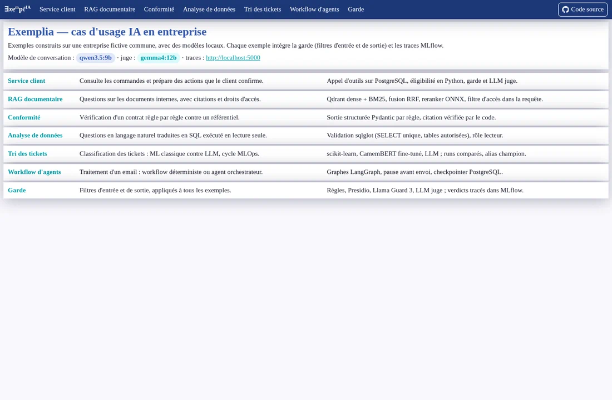

# ∃𝑥eᵐpℓᴵᴬ

**Exemplia** — exemples de référence des cas d'usage d'IA les plus fréquents en entreprise, sur
modèles locaux, avec garde (filtres d'entrée et de sortie), évaluation et observabilité intégrées.

Tous les exemples partagent une entreprise fictive neutre, « Entreprise Exemple » (produits
génériques, clients, commandes, tickets, quelques documents), et une application web FastAPI.



## Exemples

| Exemple | Ce qu'il fait | Mise en œuvre | Documentation |
|---|---|---|---|
| Service client | Consulte les commandes et prépare des actions que le client confirme. | Appel d'outils sur PostgreSQL, éligibilité en Python, garde et LLM juge. | [service_client](src/exemplia/service_client/README.md) |
| RAG documentaire | Questions sur les documents internes, avec citations et droits d'accès. | Qdrant dense + BM25, fusion RRF, reranker ONNX, filtre d'accès dans la requête. | [rag](src/exemplia/rag/README.md) |
| Conformité | Vérification d'un contrat règle par règle contre un référentiel. | Sortie structurée Pydantic par règle, citation vérifiée par le code. | [conformite](src/exemplia/conformite/README.md) |
| Analyse de données | Questions en langage naturel traduites en SQL exécuté en lecture seule. | Validation sqlglot (SELECT unique, tables autorisées), rôle lecteur. | [analyse_donnees](src/exemplia/analyse_donnees/README.md) |
| Tri des tickets | Classification des tickets : ML classique contre LLM, cycle MLOps. | scikit-learn, CamemBERT fine-tuné, LLM ; runs comparés, alias champion. | [tri_tickets](src/exemplia/tri_tickets/README.md) |
| Workflow d'agents | Traitement d'un email : workflow déterministe ou agent orchestrateur. | Graphes LangGraph, pause avant envoi, checkpointer PostgreSQL. | [workflow_agents](src/exemplia/workflow_agents/README.md) |
| Garde — module transverse | Filtres d'entrée et de sortie, appliqués à tous les exemples. | Règles, Presidio, Llama Guard 3, LLM juge ; verdicts tracés dans MLflow. | [garde](src/exemplia/garde/README.md) |

Hors application web : [Vertex AI + Gemini](src/exemplia/vertex_gemini/README.md), appel minimal
d'un modèle cloud.

## Démarrage

Prérequis : Python 3.12, [uv](https://docs.astral.sh/uv/), Docker, Ollama.

```bash
make setup      # dépendances, services Docker, modèles Ollama, données de l'entreprise et index
make start      # application web sur http://127.0.0.1:8000
make stop       # arrête les services ; les données restent dans les volumes Docker
```

`make` sans argument liste les cibles disponibles.

`make setup` installe le groupe `gpu` (PyTorch, transformers) : c'est la configuration de référence.
Sans carte graphique :

```bash
make setup-cpu  # même installation, sans PyTorch
```

Tous les exemples fonctionnent alors, à deux exceptions près : le fine-tuning de CamemBERT
(`make experiences`) et le classifieur d'injection de la garde.

## Documentation

Toute la documentation se lit aussi sur le site https://tekio.org/exemplia/.

| Document | Contenu |
|---|---|
| [Installation et exécution](doc/installation.md) | détail des cibles `make`, variante sans GPU, modèles par défaut, contexte Ollama |
| [Architecture](doc/architecture.md) | principes, vue d'ensemble, briques techniques, modules transversaux, arborescence |
| [Évaluation et résultats](doc/evaluation.md) | tests, jeux d'évaluation, scores mesurés avec les modèles locaux |

## Licence

[MIT](LICENSE) — Xavier Manach.
