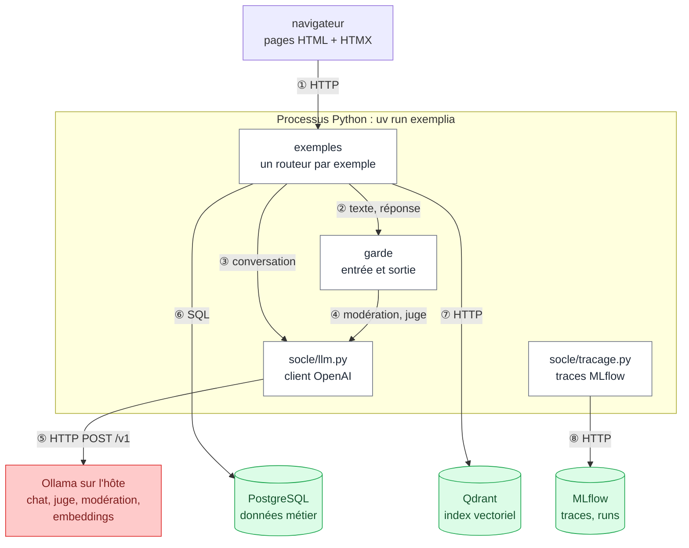

# Architecture

Les exemples sont écrits comme on les construirait en contexte professionnel : modèles locaux,
garde, évaluation et traces dès le départ. Chacun répond à trois questions — quel besoin il couvre
et quand ce modèle d'architecture est le bon choix, comment il fonctionne, comment on le fiabilise.
Le public visé : développeurs, architectes et équipes data qui cherchent un point de départ concret
et lisible, pas une plateforme clé en main.

## Principes

| Principe | Conséquence |
|---|---|
| Lisibilité avant abstraction | Code explicite, peu de couches. Un framework n'est utilisé que s'il apporte une capacité réelle (LangGraph pour l'état et la pause humaine, MLflow pour le cycle de vie). |
| Modèles locaux par défaut | Tous les appels passent par l'API compatible OpenAI d'Ollama. Un seul exemple utilise un service cloud (Vertex AI + Gemini), volontairement minimal. |
| Testable sans modèle | Le client LLM est injectable. Un faux client scripté permet de tester toute la plomberie (routes, outils, garde, workflows) sans GPU ni réseau. La qualité des réponses se mesure à part, par l'évaluation. |
| Règles métier hors du LLM | Le LLM propose, le code décide : autorisations, plafonds, validations et droits d'accès sont vérifiés dans le code des outils. |
| Sécurité et mesure transversales | La garde et le LLMOps sont des modules partagés, branchés sur chaque exemple, pas des ajouts de fin de projet. |
| Données neutres et minimales | Une seule entreprise fictive sans secteur, juste assez de données pour que chaque exemple ait du sens. |
| Portable | Applications web FastAPI (ou scripts quand l'interface n'apporte rien), infrastructure en `docker compose`. Pas de notebook. |

## Vue d'ensemble



- **① Interface.** Le navigateur envoie formulaires et requêtes HTMX à l'application FastAPI, qui
  regroupe un routeur par exemple ; les pages sont rendues côté
  serveur (Jinja) et HTMX remplace des fragments sans framework front-end.
- **② Garde.** Chaque exemple fait passer le texte entrant, puis la réponse produite, par les
  contrôles de la garde : règles, Presidio, modération, LLM juge, selon ce que l'exemple active.
- **③ ④ Client LLM.** Exemples et garde n'appellent les modèles qu'à travers le client du socle, qui ne
  connaît que l'API compatible OpenAI ; il est remplacé par un faux client scripté dans les tests.
- **⑤ Ollama.** Le client appelle `/v1/chat/completions` et `/v1/embeddings`. Le serveur de modèles
  tourne sur l'hôte, pour l'accès natif au GPU ; son adresse se
  change dans `.env` (`IACU_LLM_BASE_URL`). Seul l'exemple Vertex AI, lancé à part, appelle un
  modèle cloud.
- **⑥ ⑦ Données.** PostgreSQL porte les données de l'Entreprise Exemple (avec un rôle `lecteur` en
  lecture seule pour l'analyse de données), Qdrant l'index documentaire du RAG.
- **⑧ Traces.** Chaque requête est tracée dans MLflow, qui garde aussi les runs d'évaluation et le
  registry des modèles du tri des tickets.

## Briques techniques

| Brique | Choix |
|---|---|
| Modèles | Ollama, par l'API compatible OpenAI ; Vertex AI pour l'exemple cloud |
| Agents et workflows | LangGraph |
| Sorties structurées | Pydantic |
| RAG | Qdrant (dense + BM25), fastembed (BM25, reranker) |
| Données | PostgreSQL, SQLAlchemy, sqlglot |
| ML classique | scikit-learn ; transformers pour le fine-tuning (GPU) |
| Garde | Règles, Presidio + spaCy, Llama Guard 3, LLM juge |
| Observabilité, évaluation, MLOps | MLflow 3 |
| Web | FastAPI, Jinja, HTMX |

## Infrastructure (`compose.yaml`)

| Service | Rôle | Note |
|---|---|---|
| PostgreSQL | Données de l'entreprise | Rôle `lecteur` en lecture seule pour l'analyse de données |
| Qdrant | Index vectoriel hybride (dense + BM25) | |
| MLflow | Traces, expériences, prompts, registry | Stockage SQLite dans un volume Docker |

Ollama tourne sur l'hôte, pour l'accès GPU natif. Le client LLM ne connaît que l'API OpenAI :
l'adresse du serveur se change dans `.env` (`IACU_LLM_BASE_URL`).

## Modules transversaux

| Module | Rôle | Documentation |
|---|---|---|
| Garde | Injection de prompt, données personnelles, modération, fuite du prompt, LLM juge | [garde](../src/exemplia/garde/README.md) |
| LLMOps | Traces, jeux d'évaluation, scorers, évaluation et surveillance dans MLflow | [llmops](../src/exemplia/llmops/README.md) |
| Socle | Configuration, client LLM, base de données, documents, gabarit web, données de l'entreprise fictive | [socle](../src/exemplia/socle/README.md) |

## Arborescence

```
compose.yaml                 PostgreSQL, Qdrant, MLflow
docker/postgres/init.sql     rôle lecteur en lecture seule
data/entreprise/documents/   documents de l'Entreprise Exemple (Markdown)
.github/workflows/ci.yml     ruff et pytest sur chaque push
evaluation/                  jeux d'évaluation JSONL
captures/                    captures de chaque page et animation du README
doc/                         installation, architecture, évaluation
src/exemplia/
  app.py                     application web qui regroupe les exemples
  socle/                     configuration, client LLM, base, documents, traces, gabarit web
  garde/                     filtres d'entrée et de sortie
  llmops/                    scorers, évaluation, surveillance
  service_client/ rag/ conformite/ analyse_donnees/ tri_tickets/ workflow_agents/ vertex_gemini/
    comment-ca-marche.md     explication et diagramme affichés dans la page de l'exemple
tests/
```

## Ce que les exemples ne couvrent pas

Pas d'authentification : le client connecté se choisit dans une liste. Un seul locataire, une seule
instance, pas de redondance. L'interface est en HTML et HTMX, sans framework front-end. Le seul
entraînement est celui d'un classifieur de tickets ; aucun LLM génératif n'est fine-tuné.
