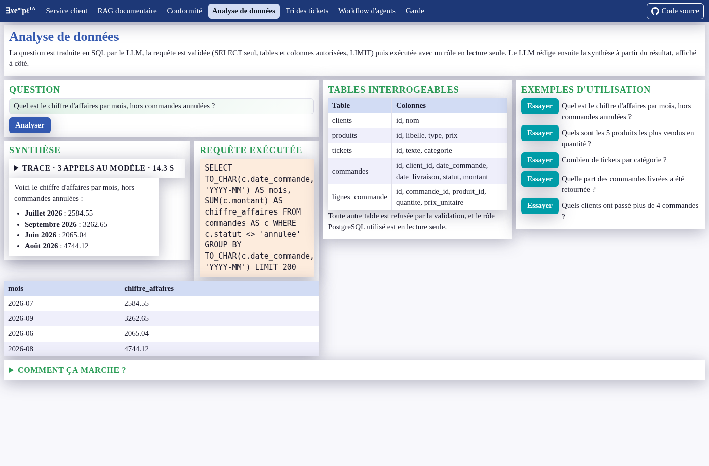

# Analyse de données

Questions en langage naturel sur les données de l'entreprise, traduites en SQL, exécutées en
lecture seule, puis résumées.

## Besoin

Permettre à un non-spécialiste d'interroger les données (« chiffre d'affaires par mois »,
« produits les plus vendus ») sans écrire de SQL, sans risque pour la base, et avec des chiffres
exacts.

## Limites

- Le LLM reçoit le schéma brut des cinq tables autorisées : une base plus large ou des
  indicateurs à définir sortent de ce que cet exemple couvre.
- La synthèse reçoit au plus 50 lignes du résultat.
- Pas de graphiques : le résultat s'affiche en table, aucun code généré n'est exécuté.

La suite : [Comment ça marche ?](comment-ca-marche.md) · [Comment utiliser ?](utilisation.md) · [Évaluation](evaluation.md).
