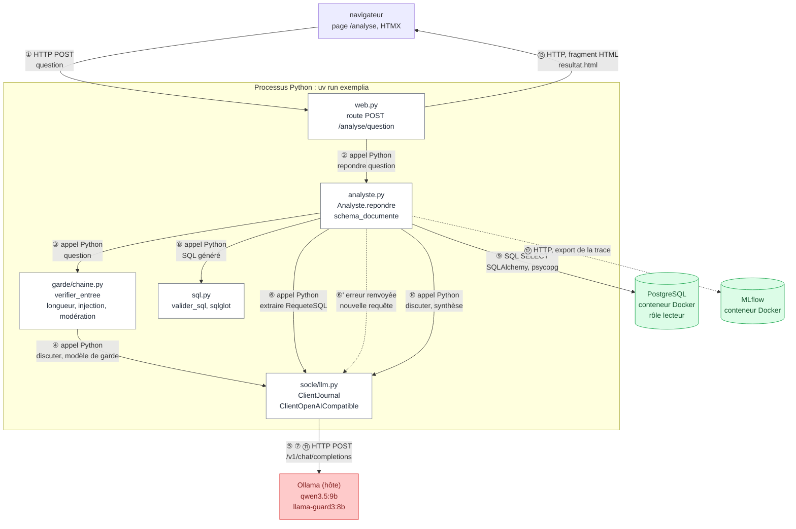

# Fonctionnement

## Détail du fonctionnement

| Protection | Ce qu'elle empêche | Où |
|---|---|---|
| Une seule instruction, arbre de type requête | `DROP`, `UPDATE`, requêtes enchaînées, CTE contenant un `DELETE` | `sql.valider_sql` |
| Liste de tables autorisées | Lecture de `journal_actions`, `information_schema`, catalogues système | `sql.valider_sql` |
| Colonnes interdites, `SELECT *` interdit sur `clients` | Lecture des emails | `sql.valider_sql` |
| Fonctions interdites (`pg_*`, `dblink`, `set_config`...) | Lecture de fichiers, attente volontaire, changement de paramètres | `sql.valider_sql` |
| `LIMIT` imposé (200) | Résultats énormes | `sql.valider_sql` |
| Rôle `lecteur` en lecture seule, `statement_timeout` de 5 s | Toute écriture, requêtes trop coûteuses, y compris si la validation a un angle mort | `docker/postgres/init.sql` |

Les deux niveaux sont nécessaires : le rôle empêche l'écriture mais pas la lecture d'une table
sensible ; la validation filtre ce qui est prévu mais peut avoir des angles morts.

**Le LLM ne calcule jamais.** Il écrit la requête puis rédige la synthèse à partir du résultat, qui
est affiché avec la requête exécutée. Le schéma envoyé au LLM est construit depuis les métadonnées
SQLAlchemy (types, clés étrangères, commentaires des colonnes) et n'inclut pas les colonnes
interdites.

## Composants de l'exemple

L'exemple tourne dans l'application web lancée par `uv run exemplia` (`app.py`, FastAPI et
uvicorn). Il lit les tables `produits`, `clients`, `commandes`, `lignes_commande` et `tickets` de la
base `entreprise`, avec la connexion `IACU_DATABASE_URL_LECTURE`. Les modèles et l'adresse du
serveur viennent de `socle/config.py` (`IACU_MODELE_CHAT`, `IACU_MODELE_GARDE`,
`IACU_LLM_BASE_URL`).

- **① Envoi de la question.** La page `/analyse` envoie la question par HTMX à
  `POST /analyse/question`.
- **② Construction de l'analyste.** `web.py` enveloppe le client LLM dans `ClientJournal` (via
  `mesurer`), construit la garde avec `garde_standard(juge=False, masquer_donnees_personnelles=False)`
  et appelle `Analyste.repondre`, tracé dans MLflow sous le nom `analyse.repondre`. Le dialecte SQL
  est déduit du moteur SQLAlchemy de lecture.
- **③ Garde d'entrée.** `verifier_entree` applique dans l'ordre le contrôle de longueur, les
  expressions régulières d'injection, puis la modération ; chaque contrôle est un span MLflow. Un
  blocage arrête tout et renvoie `MESSAGE_BLOCAGE_ENTREE`.
- **④ ⑤ Modération.** `ControleModeration` envoie la question seule au modèle `llama-guard3:8b`,
  qui répond `safe` ou `unsafe` suivi des catégories.
- **⑥ ⑦ Génération de la requête.** Le prompt système contient le schéma documenté, construit
  depuis les métadonnées SQLAlchemy des cinq tables autorisées, sans la colonne `email`.
  `extraire` demande à `qwen3.5:9b` une sortie `RequeteSQL` (raisonnement, requête), contrainte par
  un `response_format` de type `json_schema`.
- **⑧ Validation.** `valider_sql` analyse la requête avec sqlglot : une seule requête, tables
  autorisées, ni colonne `email` ni `SELECT *` sur `clients`, pas de fonctions `pg_*`, `dblink`,
  `set_config`..., et `LIMIT 200` imposé si la limite est absente ou plus grande.
- **⑨ Exécution.** La requête validée est exécutée avec le rôle PostgreSQL `lecteur`, en lecture
  seule et avec un `statement_timeout` de 5 s (`docker/postgres/init.sql`), dans un span
  `analyse.execution_sql`.
- **⑥' Correction.** Si la validation ou l'exécution échoue, le message d'erreur est ajouté à la
  conversation et le modèle propose une nouvelle requête ; `tentatives=2` donne un seul essai de
  correction, après quoi la réponse indique qu'aucune requête valide n'a été construite.
- **⑩ ⑪ Synthèse.** La question, la requête entre balises `<requete>` et au plus 50 lignes du
  résultat entre balises `<resultat>` sont envoyées à `qwen3.5:9b`, avec la consigne de n'utiliser
  que les chiffres présents.
- **⑫ Traces.** À la fin de `repondre`, la trace (spans de garde, d'exécution SQL et appels au
  client OpenAI tracés par `mlflow.openai.autolog`) part vers le serveur MLflow de
  `IACU_MLFLOW_TRACKING_URI`. Si le traçage est désactivé ou le serveur injoignable au démarrage,
  rien n'est envoyé.
- **⑬ Résultat.** `resultat.html` affiche la synthèse, la requête exécutée, le tableau du résultat,
  les erreurs de génération éventuelles et les échanges avec le modèle.

**Ce que fait le GPU.** Ollama fait tourner sur le GPU `llama-guard3:8b` pour la modération (⑤)
et `qwen3.5:9b` pour la requête et la synthèse (⑦, ⑪) : trois appels par question, plus un par
correction. Si `IACU_CLASSIFIEUR_INJECTION` est renseigné, le classifieur d'injection de la garde
tourne aussi en local, avec transformers. La validation sqlglot, l'exécution SQL dans PostgreSQL et
la mise en forme sont sur le CPU : les chiffres affichés ne passent jamais par le modèle.
