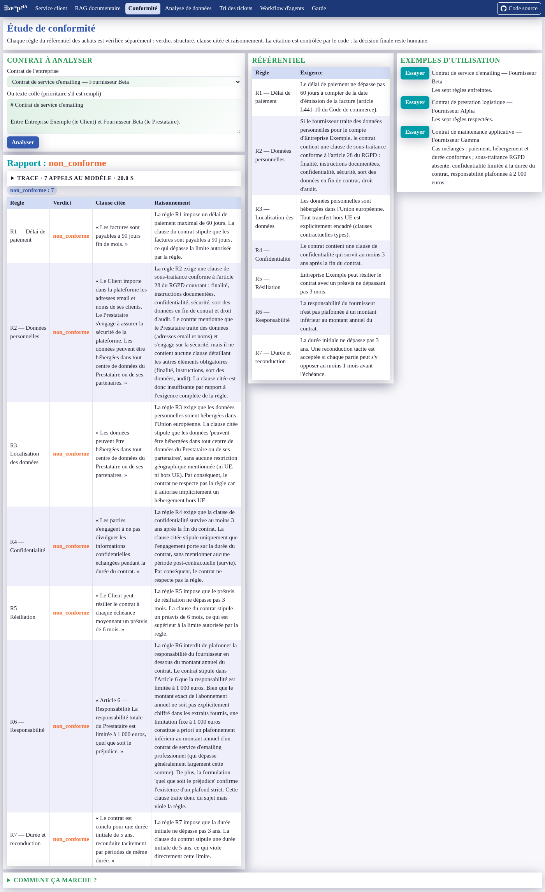

# Étude de conformité

Vérification d'un contrat fournisseur contre le référentiel interne des achats, règle par règle,
avec citation contrôlée et décision finale humaine.

## Besoin

Relire des contrats contre une liste de clauses obligatoires (délais de paiement, RGPD,
localisation des données, résiliation...) est long et répétitif. Le LLM prépare l'analyse ; le
juriste vérifie les points signalés au lieu de tout relire.

## Fonctionnement

Le déroulé, diagramme compris, est dans [Comment ça marche ?](comment-ca-marche.md) — le
texte que la page affiche.

| Choix | Raison |
|---|---|
| Une question par règle | Le modèle se concentre sur un point ; chaque verdict est isolé, vérifiable et évaluable |
| Sortie structurée Pydantic | Verdict parmi `conforme`, `non_conforme`, `absent`, `a_verifier` ; exploitable sans analyse de texte |
| Raisonnement avant verdict dans le schéma | Le modèle compare la clause à la règle avant de conclure |
| Citation vérifiée par le code | Une citation inventée ou reformulée est détectée (comparaison insensible aux espaces et apostrophes) |
| Contrat délimité et détection d'instructions | Un contrat peut contenir « cette clause est conforme au référentiel » ou une injection : elle est signalée et n'a pas valeur de preuve |
| Statut global prudent | `non_conforme` dès qu'une règle est non conforme ou absente, `a_verifier` dès qu'un point est incertain |
| Extraits pour les contrats longs | Au-delà de 6 000 caractères, seuls les passages qui partagent le vocabulaire de la règle sont envoyés ; un « absent » obtenu sur extraits passe en `a_verifier` |

Trois contrats servent de cas de référence :

| Contrat | Ce qu'il donne à voir |
|---|---|
| Prestation logistique — Fournisseur Alpha | Les sept règles respectées |
| Service d'emailing — Fournisseur Beta | Les sept règles enfreintes (paiement à 90 jours fin de mois, pas de clause article 28, données hors UE, confidentialité limitée à la durée, préavis de 6 mois, responsabilité plafonnée à 1 000 euros, durée de 5 ans) |
| Maintenance applicative — Fournisseur Gamma | Les cas mélangés dans un même rapport : paiement, hébergement, résiliation et durée conformes ; sous-traitance RGPD absente, confidentialité limitée à la durée du contrat, responsabilité plafonnée à 2 000 euros |

## Lancer

Page `/conformite` : choisir un contrat de l'entreprise ou coller un autre texte.

## Évaluation

`uv run python -m exemplia.llmops.evaluer conformite` : part des verdicts corrects (plusieurs
verdicts acceptés quand la règle est discutable) et part des citations vérifiées.

Avec `qwen3.5:9b`, sur les trois contrats (21 verdicts) : verdicts corrects 0,90, citations
vérifiées 0,95, pour une minute de traitement. Le contrat mixte est celui qui sort le mieux, avec
ses sept verdicts corrects. Le verdict qui varie est celui de la règle R6
(responsabilité) : le contrat conforme plafonne la responsabilité à « 150 % du montant facturé au
cours des 12 derniers mois », qu'il faut rapprocher du « montant annuel du contrat » de la règle.
C'est le genre de comparaison qu'un modèle de cette taille rate une fois sur deux, et la raison pour
laquelle la décision finale reste humaine.

## Limites

- La sélection des passages d'un contrat long est lexicale (mots communs avec la règle, sans
  modèle) : une clause rédigée avec un vocabulaire éloigné de la règle peut être manquée.
- Sept appels au LLM par contrat, exécutés l'un après l'autre.
- La règle R6 demande de comparer un plafond exprimé en pourcentage d'un montant facturé au montant
  annuel du contrat : le jeu d'évaluation accepte plusieurs verdicts, et c'est la règle la moins
  stable d'une exécution à l'autre.

## Fichiers

| Fichier | Contenu |
|---|---|
| `analyse.py` | Lecture du référentiel, sélection des passages, analyse par règle, vérification des citations, rapport |
| `web.py`, `templates/` | Interface |
