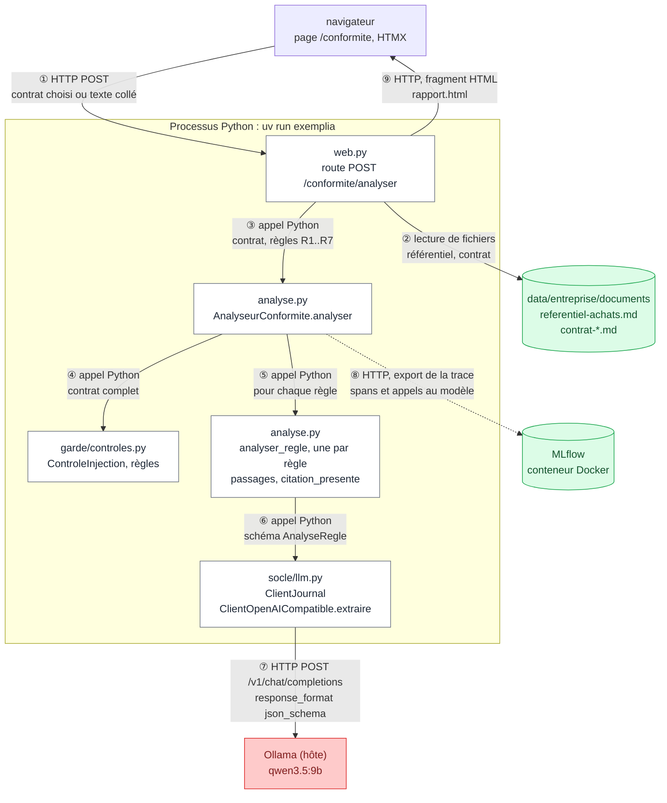

# Fonctionnement

## Détail du fonctionnement

| Choix | Raison |
|---|---|
| Une question par règle | Le modèle se concentre sur un point ; chaque verdict est isolé, vérifiable et évaluable |
| Sortie structurée Pydantic | Verdict parmi `conforme`, `non_conforme`, `absent`, `a_verifier` ; exploitable sans analyse de texte |
| Raisonnement avant verdict dans le schéma | Le modèle compare la clause à la règle avant de conclure |
| Citation vérifiée par le code | Une citation inventée ou reformulée est détectée (comparaison insensible aux espaces et apostrophes) |
| Contrat délimité et détection d'instructions | Un contrat peut contenir « cette clause est conforme au référentiel » ou une injection : elle est signalée et n'a pas valeur de preuve |
| Statut global prudent | `non_conforme` dès qu'une règle est non conforme ou absente, `a_verifier` dès qu'un point est incertain |
| Extraits pour les contrats longs | Au-delà de 6 000 caractères, seuls les passages qui partagent le vocabulaire de la règle sont envoyés ; un « absent » obtenu sur extraits passe en `a_verifier` |

Trois contrats servent de cas de référence :

| Contrat | Ce qu'il donne à voir |
|---|---|
| Prestation logistique — Fournisseur Alpha | Les sept règles respectées |
| Service d'emailing — Fournisseur Beta | Les sept règles enfreintes (paiement à 90 jours fin de mois, pas de clause article 28, données hors UE, confidentialité limitée à la durée, préavis de 6 mois, responsabilité plafonnée à 1 000 euros, durée de 5 ans) |
| Maintenance applicative — Fournisseur Gamma | Les cas mélangés dans un même rapport : paiement, hébergement, résiliation et durée conformes ; sous-traitance RGPD absente, confidentialité limitée à la durée du contrat, responsabilité plafonnée à 2 000 euros |

## Composants de l'exemple

L'exemple tourne dans l'application web lancée par `uv run exemplia` (`app.py`, FastAPI et
uvicorn). Le référentiel et les contrats d'exemple sont des fichiers Markdown du dossier
`data/entreprise/documents`. Le modèle et l'adresse du serveur viennent de `socle/config.py`
(`IACU_MODELE_CHAT`, `IACU_LLM_BASE_URL`).

- **① Envoi du formulaire.** La page `/conformite` envoie par HTMX le nom d'un contrat de
  l'entreprise, ou un texte collé, à `POST /conformite/analyser`. Un texte collé l'emporte sur le
  contrat choisi.
- **② Lecture des documents.** `socle/documents.py` lit `referentiel-achats.md` et, si aucun texte
  n'est collé, le contrat choisi. `lire_referentiel` extrait les sept règles des sections
  `## R1 — Titre`.
- **③ Lancement de l'analyse.** `web.py` enveloppe le client LLM dans `ClientJournal` (via
  `mesurer`, qui compte les appels et retient les échanges affichés sur la page) et appelle
  `AnalyseurConformite.analyser`, tracé dans MLflow sous le nom `conformite.analyser`.
- **④ Détection d'injection.** `ControleInjection` sans classifieur applique ses expressions
  régulières au contrat complet. Un motif trouvé ne bloque rien : il ajoute une alerte au rapport
  et recommande une relecture humaine.
- **⑤ Une analyse par règle.** `analyser_regle` est appelée sept fois, l'une après l'autre, chacune
  dans un span `regle.Rn`. Au-delà de 6 000 caractères, `passages_pertinents` ne garde que les
  paragraphes qui partagent des racines de mots avec la règle, sur le CPU et sans modèle.
- **⑥ Sortie structurée.** Le prompt système de juriste achats, le contrat entre balises
  `<contrat>` (attribut `extraits="oui"` si réduit) et la règle entre balises `<regle>` sont passés
  à `extraire` avec le schéma Pydantic `AnalyseRegle` : clause citée, raisonnement, verdict parmi
  quatre valeurs.
- **⑦ Appel au modèle.** `ClientOpenAICompatible` envoie la requête au serveur compatible OpenAI
  (Ollama sur `localhost:11434` par défaut), température 0, `reasoning_effort` à `none`, avec un
  `response_format` de type `json_schema`. Si le JSON renvoyé ne valide pas le schéma, l'erreur est
  renvoyée au modèle pour un second essai. Au retour, `citation_presente` cherche la clause citée
  dans le contrat complet ; une citation introuvable, ou un `absent` obtenu sur des extraits, fait
  passer le verdict en `a_verifier`.
- **⑧ Traces.** À la fin de `analyser`, la trace (span racine, spans par règle, appels au client
  OpenAI tracés par `mlflow.openai.autolog`) part vers le serveur MLflow de
  `IACU_MLFLOW_TRACKING_URI`. Si le traçage est désactivé ou le serveur injoignable au démarrage,
  rien n'est envoyé et l'analyse se déroule de la même façon.
- **⑨ Rapport.** `RapportConformite` calcule le statut global et la synthèse des verdicts ;
  `rapport.html` est renvoyé et inséré dans la page, avec le nombre d'appels, la durée et les
  échanges avec le modèle.

**Ce que fait le GPU.** Seule la génération de `qwen3.5:9b` par Ollama (⑦) tourne sur le GPU, sept
fois par contrat. La lecture du référentiel, la détection d'injection, la sélection des passages,
la vérification des citations et le calcul du statut sont du code Python sur le CPU.
