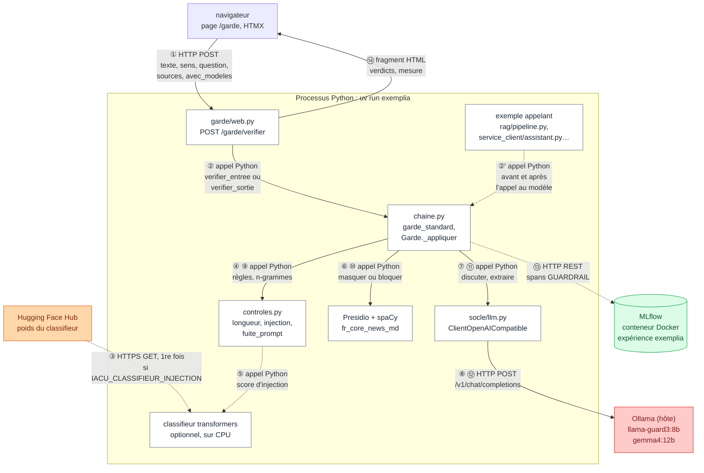

# Fonctionnement

## Détail du fonctionnement

Chaque contrôle renvoie un `Verdict` : `autoriser`, `modifier` (texte remplacé, par exemple données
masquées) ou `bloquer`, avec sa raison. La chaîne s'arrête au premier blocage. Les contrôles sont
rangés du moins coûteux au plus coûteux : le juge n'est appelé que si tout le reste est passé.

| Contrôle | Sens | Technique | Coût |
|---|---|---|---|
| `ControleLongueur` | entrée | Règle | nul |
| `ControleInjection` | entrée | Expressions régulières sur texte normalisé (accents, caractères invisibles) : consignes ignorées, changement de rôle, jeu de rôle, balises de gabarit ; classifieur optionnel | nul |
| `ControleDonneesPersonnelles` | entrée : masquer ; sortie : bloquer IBAN et carte | Presidio + spaCy français (`fr_core_news_md`) | ~10 ms |
| `ControleModeration` | entrée | Llama Guard 3 8B servi par Ollama (`safe` / `unsafe` + catégories) | un appel, ~60 ms modèle chargé |
| `ControleFuitePrompt` | sortie | N-grammes communs avec les consignes du prompt système (sans les documents ni le périmètre, que la réponse peut légitimement reprendre) | nul |
| `JugeLLM` | sortie | LLM juge avec critères, sortie structurée | un appel au juge |

`garde_standard(client, perimetre)` assemble la configuration de référence. Sans client, seuls les
contrôles sans modèle sont actifs.

La page `/garde` suit l'ordre chronologique : on choisit d'abord le sens et si les contrôles à base
de modèle sont actifs, puis les champs qui en découlent. En sortie, ils reconstituent ce que
l'assistant avait sous les yeux — question du client, résultats des outils — avant la réponse à
contrôler, puisque c'est vous qui écrivez à sa place.

Les exemples couvrent les quatre combinaisons, parce que les contrôles à base de modèle existent
dans les deux sens :

| | Sans modèle | Avec modèle |
|---|---|---|
| Entrée | injection bloquée par les règles, données personnelles masquées par Presidio | contenu dangereux, que seule la modération attrape |
| Sortie | IBAN bloqué par Presidio | réponse inventée, que seul le juge attrape |

## Composants

Le schéma suit un passage en entrée (③ à ⑧), puis un passage en sortie (⑨ à ⑫). Un exemple fait les deux autour de son propre appel au modèle ; la page `/garde` n'en fait qu'un par requête, selon le sens choisi.

- **① Requête de la page.** Le formulaire de `/garde` envoie par `hx-post` le texte, le sens (`entree` ou `sortie`), la case `avec_modeles` et, en sortie, la question et les sources (séparées par `---`).
- **② Appel depuis la page.** `web.verifier` construit `garde_standard(client, perimetre="service client d'Entreprise Exemple")` à chaque requête, avec `client_par_defaut()` enveloppé dans `ClientJournal` si la case est cochée, sans client sinon : la modération et le juge sont alors absents de la chaîne. Il appelle ensuite `verifier_entree(texte)` ou `verifier_sortie(texte, {"question", "sources"})`.
- **②' Appel depuis un exemple.** Les exemples reçoivent une `Garde` construite par leur `web.py` avec `garde_standard`, et appellent `verifier_entree(question)` avant le modèle, puis `verifier_sortie(reponse, contexte)` avec la question, les sources et `prompt_systeme`. Le RAG désactive le masquage des données personnelles en entrée ; l'analyse de données le désactive aussi, sans juge, et n'appelle que `verifier_entree`. Sur blocage, l'exemple renvoie `MESSAGE_BLOCAGE_ENTREE` ou `MESSAGE_BLOCAGE_SORTIE`.
- **③ Téléchargement du classifieur.** Seulement si `IACU_CLASSIFIEUR_INJECTION` désigne un modèle : `garde_standard` appelle `classifieur_transformers`, qui crée un pipeline `text-classification` de transformers sur CPU. Les poids sont téléchargés du Hub au premier chargement, puis relus depuis le cache local ; le pipeline est gardé en mémoire (`lru_cache`).
- **④ Règles d'entrée.** `ControleLongueur` bloque un message vide ou de plus de 4 000 caractères. `ControleInjection` normalise le texte (minuscules, sans accents ni caractères invisibles) et le confronte aux expressions régulières de `MOTIFS_INJECTION` ; un motif trouvé bloque.
- **⑤ Classifieur.** Sans motif trouvé et avec un classifieur configuré, le score de la classe « injection » est comparé à `IACU_CLASSIFIEUR_INJECTION_SEUIL` (0,8). Au-dessus, le verdict reste `autoriser` avec le score dans la raison, sauf si `IACU_CLASSIFIEUR_INJECTION_BLOQUE` est activé.
- **⑥ Données personnelles en entrée.** `ControleDonneesPersonnelles` analyse le texte avec Presidio et spaCy `fr_core_news_md` (nom, email, téléphone, IBAN, carte), écarte les « personnes » sans nom propre, et remplace les entités trouvées par leur type (`MODIFIER`) : les contrôles suivants et le modèle reçoivent le texte masqué.
- **⑦ Modération.** `ControleModeration` envoie le texte seul, en message `user`, par `ClientLLM.discuter` avec le modèle `IACU_MODELE_GARDE` (`llama-guard3:8b`).
- **⑧ Réponse de Llama Guard.** Requête Chat Completions vers Ollama (`IACU_LLM_BASE_URL`, `http://localhost:11434/v1` par défaut). Une réponse qui commence par `unsafe` bloque, les catégories suivantes (`S1`…) vont dans les détails du verdict.
- **⑨ Règles de sortie.** `ControleFuitePrompt` bloque la réponse si elle partage au moins un 8-gramme de mots normalisés avec `contexte["prompt_systeme"]` ; sans prompt système dans le contexte, comme sur la page `/garde`, il autorise.
- **⑩ Données sensibles en sortie.** Le même contrôle Presidio, restreint à `IBAN_CODE` et `CREDIT_CARD`, bloque au lieu de masquer.
- **⑪ Juge.** `JugeLLM` place la question, chaque source et la réponse entre balises avec `prompts.delimiter`, ajoute les critères (périmètre, fidélité aux sources, propos dangereux, promesses) et appelle `ClientLLM.extraire` avec le schéma `AvisJuge` et le modèle `IACU_MODELE_JUGE` (`gemma4:12b`).
- **⑫ Réponse du juge.** La requête porte un `response_format` `json_schema` ; la réponse est validée par Pydantic, avec une nouvelle tentative si elle est invalide. `acceptable: false` bloque, avec `probleme` pour raison.
- **⑬ Traces.** Chaque contrôle s'exécute dans un span `GUARDRAIL` nommé `garde.<sens>.<contrôle>`, avec le texte en entrée, la décision, la raison et les détails en sortie ; les appels à Ollama y sont rattachés par l'autolog OpenAI. Les spans partent vers MLflow quand `tracage.activer("exemplia")` a réussi au démarrage. Appelée par un exemple, la garde s'inscrit dans la trace de l'exemple ; sur la page `/garde`, aucun span parent n'est ouvert, chaque contrôle forme sa propre trace.
- **⑭ Résultat.** `garde/resultat.html` affiche chaque verdict, la décision finale, le texte éventuellement masqué et, via `mesurer`, le nombre d'appels au modèle, la durée et les messages échangés. Un exemple reçoit à la place un `ResultatGarde` (`decision`, `texte`, `verdicts`).

La chaîne s'arrête au premier verdict `bloquer` : les étapes suivantes n'ont pas lieu.

**Ce que fait le GPU.** Seul Ollama calcule sur le GPU : Llama Guard 3 (⑧) lit le message et génère quelques jetons (`safe`, ou `unsafe` et une catégorie) ; le juge (⑫) génère un objet JSON contraint par le schéma. Les deux modèles alternent en mémoire avec le modèle de l'exemple. Les règles, les n-grammes, Presidio et spaCy tournent sur le CPU, de même que le classifieur d'injection, chargé par défaut sur `cpu`.

## Injection indirecte

Le filtre d'entrée ne voit que le message de l'utilisateur. Les documents, emails et résultats
d'outils passent par `prompts.delimiter` : ils sont placés entre balises (`<document>`,
`<resultat_outil>`…), toute balise identique dans le contenu est neutralisée, et
`CONSIGNE_CONTENU_NON_FIABLE` indique au modèle que ce contenu est une donnée. Cela réduit le
risque sans l'éliminer : c'est pourquoi les actions sensibles sont aussi vérifiées par le code et
confirmées par un humain (voir service client et workflow).

## Traces

Chaque contrôle est un span MLflow de type `GUARDRAIL` (`garde.entree.injection`…), avec la
décision et sa raison.
