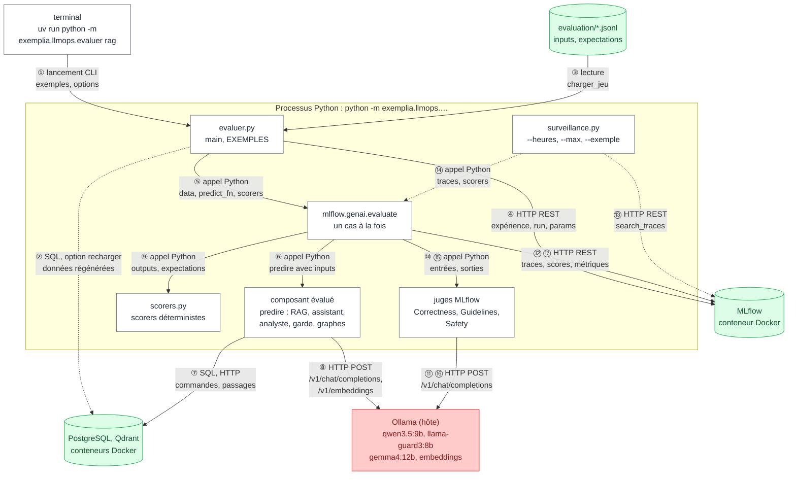

# LLMOps

Observabilité, évaluation et surveillance des exemples avec MLflow 3.

## Besoin

Un assistant LLM change de comportement dès qu'on modifie un prompt, un modèle ou un paramètre. Sans
mesure, on ne sait pas si une modification améliore ou dégrade. Il faut :

- **voir** ce qui s'est passé pour une requête (traces) ;
- **mesurer** la qualité sur un jeu de test fixe, avant chaque mise en production (évaluation) ;
- **suivre** la qualité réelle en production (surveillance).

## Composants



Les étapes ① à ⑫ sont une évaluation, `python -m exemplia.llmops.evaluer <exemple>`, répétées pour chaque exemple demandé. Les étapes ⑬ à ⑰ sont la surveillance, `python -m exemplia.llmops.surveillance`, lancée séparément ; elle réutilise `mlflow.genai.evaluate` et les juges.

- **① Lancement.** `evaluer.main` reçoit un ou plusieurs exemples parmi `EXEMPLES` (`service_client`, `rag`, `conformite`, `analyse_donnees`, `garde`, `workflow`) et l'option `--recharger`. Il fixe `MLFLOW_GENAI_EVAL_MAX_WORKERS=1` et active `mlflow.openai.autolog()`.
- **② Rechargement.** Avec `--recharger`, `entreprise.charger(moteur(), entreprise.generer())` régénère les données de l'entreprise dans PostgreSQL, pour que les commandes citées par les jeux retrouvent leur statut initial.
- **③ Jeu de test.** `charger_jeu` lit `evaluation/<exemple>.jsonl`, une ligne `{"inputs", "expectations"}` par cas. Pour `analyse_donnees`, `_jeu_analyse` exécute en plus chaque `sql_reference` sur la base en lecture seule et ajoute le résultat aux attentes. Le jeu du workflow est construit depuis `workflow_agents/emails.py`, chaque email étant évalué avec les deux architectures.
- **④ Run.** Pour chaque exemple, `mlflow.set_experiment("evaluation-<exemple>")` puis un run nommé `<exemple>-<modèle de chat>`, avec en paramètres `modele_chat`, `modele_juge` et `modele_embeddings`.
- **⑤ Évaluation.** La fonction `evaluer_<exemple>` construit le vrai composant avec `client_par_defaut()` et renvoie `predire` et la liste des scorers. `predire` est enveloppée dans `mlflow.trace(name="evaluation.<exemple>")` pour servir de span racine, puis passée à `mlflow.genai.evaluate` avec le jeu.
- **⑥ Prédiction.** Pour chaque cas, `predire(**inputs)` appelle le composant (`RAG.repondre`, `AssistantServiceClient.repondre`, `Analyste.repondre`, `AnalyseurConformite.analyser`, `Garde.verifier_entree`, graphe LangGraph) et renvoie un dictionnaire de sorties : réponse, outils appelés, action proposée, documents retenus, SQL, verdicts…
- **⑦ Données.** Le composant lit ce dont il a besoin : commandes et tables en SQL dans PostgreSQL (service client, analyse de données, workflow), passages par HTTP dans Qdrant pour le RAG, dont le reranker ONNX tourne dans le processus. La conformité lit ses contrats dans `data/entreprise/documents`.
- **⑧ Modèles du composant.** Les appels passent par `ClientOpenAICompatible` vers `IACU_LLM_BASE_URL` : modèle de chat `qwen3.5:9b`, modération `llama-guard3:8b` et juge de sortie `gemma4:12b` quand la garde du composant les inclut, embeddings `qwen3-embedding:0.6b` pour la recherche du RAG.
- **⑨ Scorers déterministes.** Chaque scorer `@scorer` de `scorers.py` compare `outputs` aux `expectations` du cas et renvoie un booléen, une fraction, un compte (`appels_llm`) ou `None` quand l'attente correspondante est absente.
- **⑩ Juges.** `exactitude()` (`Correctness`, RAG) et `consignes()` (`Guidelines`, service client et workflow) reçoivent les entrées et sorties du span racine. Leur modèle est `uri_juge()`, soit `ollama:/gemma4:12b`, avec `parametres_juge()` (`reasoning_effort` repris de `IACU_LLM_REFLEXION`).
- **⑪ Appel au juge.** L'adaptateur de MLflow pour le fournisseur `ollama` envoie une requête Chat Completions à `http://localhost:11434/v1`, son adresse par défaut, indépendante de `IACU_LLM_BASE_URL`. Le juge renvoie une valeur (`yes`/`no`) et une justification.
- **⑫ Enregistrement.** Les traces de chaque cas, avec les appels au modèle captés par l'autolog, les valeurs des scorers et les métriques agrégées vont dans le run. Le script affiche ensuite les métriques, les moyennes par architecture pour le workflow, et les cas en échec avec leur sortie et la justification du juge.
- **⑬ Traces de production.** `surveillance.py` interroge l'expérience `exemplia` : traces au statut `OK` des dernières `--heures` (24), au plus `--max` (50), éventuellement filtrées sur le tag `exemple`. Seules les traces qui portent ce tag sont gardées.
- **⑭ Évaluation sans référence.** Les traces sont passées comme données à `mlflow.genai.evaluate`, sans fonction de prédiction, dans l'expérience `surveillance`, avec deux juges : `consignes_production` (`Guidelines` sur trois règles) et `Safety`.
- **⑮ ⑯ Juges sur les traces**, par le même chemin que ⑩ et ⑪.
- **⑰ Enregistrement** des scores dans un run `traces-<heures>h` de l'expérience `surveillance`, avec le nombre de traces en paramètre.

**Ce que fait le GPU.** Tout le calcul de modèles passe par Ollama : génération et appels d'outils du composant évalué (⑧), modération, embeddings, puis génération de chaque jugement (⑪, ⑯). Les cas étant évalués un par un, Ollama charge tour à tour le modèle de chat, Llama Guard et le juge dans la mémoire du GPU. Les scorers déterministes, la lecture des jeux et l'agrégation des métriques tournent sur le CPU.

## Traces

Activées par le socle (`socle/tracage.py`) dans l'expérience `exemplia` :

| Source | Contenu |
|---|---|
| Autolog OpenAI | Chaque appel au serveur de modèles : messages, réponse, jetons, latence |
| Autolog LangChain | Nœuds des graphes LangGraph |
| `@mlflow.trace` et spans | Étapes métier : `service_client.repondre`, `rag.recherche_hybride` (RETRIEVER), `rag.rerank` (RERANKER), outils (TOOL), garde (GUARDRAIL) |

Chaque réponse de l'application affiche sa propre trace (appels au modèle, messages envoyés,
durée) et renvoie vers l'onglet « Traces » de l'expérience dans MLflow, où les mêmes échanges
apparaissent avec leurs spans et leurs durées.

Toutes les traces de l'application portent le tag `exemple` ; celles du service client ont aussi
l'utilisateur et la session (`mlflow.trace.user`, `mlflow.trace.session`), celles du workflow
l'architecture et l'identifiant du traitement. Les nœuds des graphes LangGraph sont tracés par
l'autolog sous le span `workflow.executer`.

## Évaluation

```bash
uv run python -m exemplia.llmops.evaluer rag service_client
uv run python -m exemplia.llmops.evaluer --recharger service_client workflow
```

Les jeux du service client et du workflow citent des commandes dont le statut détermine le résultat
attendu : ils supposent les données dans leur état initial. Une démonstration qui annule ou retourne
une commande fausse les cas correspondants, d'où `--recharger`, qui régénère les données avant
d'évaluer.

Chaque exemple a un jeu de test, une fonction de prédiction qui appelle le vrai composant, et des
scorers. `mlflow.genai.evaluate` exécute le tout, trace chaque cas et enregistre les métriques dans
l'expérience `evaluation-<exemple>`. Le script affiche ensuite les cas en échec, avec la sortie et
la justification du juge.

La fonction de prédiction est tracée comme span racine (`evaluation.<exemple>`) : les juges
évaluent ses entrées et sorties. Sans ce span, MLflow prend un appel au modèle interne au composant
(un prompt de plusieurs milliers de jetons) et le juge, limité par le contexte du serveur, renvoie
une réponse vide.

Les cas sont évalués un par un (`MLFLOW_GENAI_EVAL_MAX_WORKERS=1` par défaut) : sur un seul GPU, des
cas en parallèle obligent Ollama à alterner sans cesse modèle évalué, modèle de garde et juge en
mémoire.

| Exemple | Jeu | Scorers déterministes | Juges LLM |
|---|---|---|---|
| `service_client` | `evaluation/service_client.jsonl` (12 demandes) | outils attendus appelés, action proposée, escalade | consignes (politesse, pas d'action annoncée comme faite, pas de geste commercial, hors sujet décliné) |
| `rag` | `evaluation/rag.jsonl` (13 questions) | rappel des documents attendus, aucune fuite d'accès, présence ou absence de citations | `Correctness` (faits attendus) |
| `conformite` | `evaluation/conformite.jsonl` (3 contrats) | verdicts corrects par règle, citations vérifiées | — |
| `analyse_donnees` | `evaluation/analyse_donnees.jsonl` (10 questions) | requête exécutée, résultat identique à la requête de référence | — |
| `garde` | `evaluation/garde.jsonl` (20 messages) | blocage correct (attaques et messages légitimes) | — |
| `workflow` | `workflow_agents/emails.py` × 2 architectures | action proposée, escalade, nombre d'appels LLM | consignes sur le brouillon |

Principes :

- **Le code vérifie tout ce qui peut l'être** : outil appelé, verdict, résultat SQL. Ces scorers
  sont gratuits et reproductibles. Les juges ne servent qu'à ce que le code ne sait pas mesurer.
- **Le juge est un autre modèle** que celui évalué (`IACU_MODELE_JUGE`), désigné par
  `uri_juge()` au format MLflow (`ollama:/gemma4:12b`), avec les mêmes options d'inférence que le
  reste du projet (`parametres_juge()`).
- Pour l'analyse de données, le résultat attendu est recalculé sur la base à chaque évaluation à
  partir de la requête de référence : le jeu reste valable si les données sont rechargées.
- Un scorer qui renvoie `None` est ignoré pour ce cas (expectation absente).
- MLflow refuse une expectation de valeur nulle : l'absence d'action attendue s'écrit `"aucune"`.

Comparer deux configurations : changer le modèle ou le prompt, relancer l'évaluation, comparer les
deux runs dans l'interface MLflow.

## Surveillance

```bash
uv run python -m exemplia.llmops.surveillance --heures 24 --max 50 --exemple service_client
```

Échantillonne les traces récentes de l'application et les note avec des juges sans référence
(consignes de production, `Safety`). Les résultats vont dans l'expérience `surveillance`. À planifier
(cron) pour suivre l'évolution dans le temps.

## MLOps du tri des tickets

Le cycle complet (runs comparés, Model Registry, alias `champion`, Prompt Registry) est montré dans
[tri_tickets](../tri_tickets/README.md).

## Résultats de référence

Modèles par défaut (`qwen3.5:9b`, juge `gemma4:12b`, modération `llama-guard3:8b`,
embeddings `qwen3-embedding:0.6b`), GPU de 12 Go :

| Exemple | Résultats | Durée |
|---|---|---|
| `garde` | blocage correct 0,90 (0 faux positif sur 11 messages légitimes) | < 1 min |
| `rag` | rappel 1,0 · aucune fuite d'accès · citations 1,0 · exactitude (juge) 0,92 | ~8 min |
| `service_client` | consignes (juge) 1,0 · mentions 1,0 · action 0,92 · escalade 0,91 · outils 0,80 | ~10 min |
| `conformite` | 3 contrats, 21 verdicts : verdicts corrects 0,90 · citations vérifiées 0,95 | ~1 min |
| `analyse_donnees` | requête exécutée 1,0 · résultat identique à la référence 1,0 | ~2 min |
| `workflow` | action 1,0 · escalade 1,0 · brouillon (juge) 1,0 ; 2,1 appels LLM (workflow) contre 5,0 (orchestrateur) | ~12 min |

Le juge est le poste le plus lent (10 à 55 s par jugement).

## Limites

- Avec vLLM au lieu d'Ollama, `uri_juge()` produit `openai:/<modèle>` : il faut alors pointer le
  fournisseur OpenAI de MLflow vers le serveur vLLM, ou construire les juges avec
  `mlflow.genai.make_judge(..., base_url=...)`.
- Les jeux comptent quelques dizaines de cas : ils détectent les régressions nettes, pas les écarts
  de quelques points. On les enrichit avec les cas réels mal traités repérés en surveillance.
- Le juge renvoie parfois un contenu vide, sur lequel MLflow échoue (`Failed to parse response from
  judge model`) : le scorer est alors en erreur pour ce cas, sans que l'évaluation s'arrête. Le même
  appel rejoué aboutit ; c'est une instabilité du serveur de modèles, pas un problème de prompt.
- Deux exécutions identiques ne donnent pas exactement les mêmes scores : le serveur de modèles
  n'est pas déterministe d'un lot à l'autre, et le juge lui-même varie. Comparer des écarts d'un
  point n'a pas de sens ; répéter l'évaluation avant de conclure sur un changement fin.

## Fichiers

| Fichier | Contenu |
|---|---|
| `scorers.py` | Scorers déterministes et fabriques de juges |
| `evaluer.py` | Fonctions de prédiction et lancement des évaluations |
| `surveillance.py` | Évaluation des traces de production |
