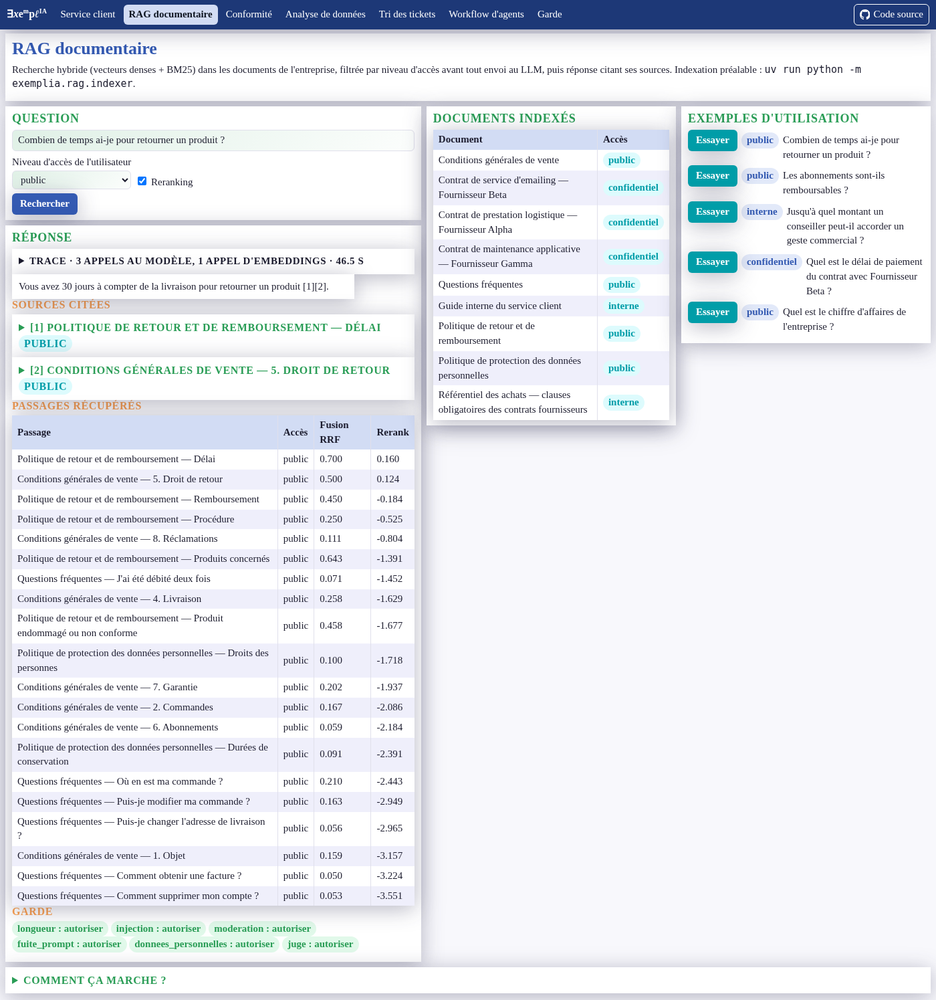
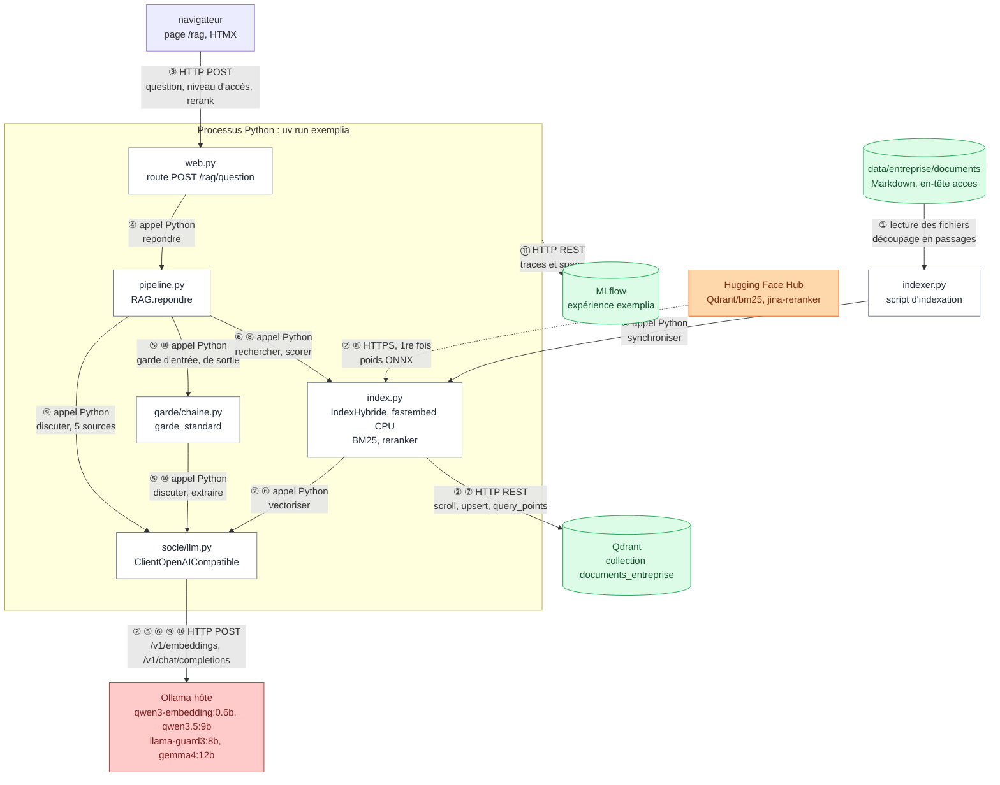

# RAG documentaire



Questions en langage naturel sur les documents de l'entreprise, avec réponse citée et filtrage par
niveau d'accès.

## Besoin

Quand la base documentaire dépasse ce qu'on peut mettre dans un prompt, on récupère d'abord les
passages pertinents, puis le LLM répond à partir d'eux seuls. En entreprise, trois exigences
s'ajoutent à la version de démonstration habituelle :

- **droits d'accès** : un collaborateur ne doit pas obtenir, même reformulé, le contenu d'un
  document qu'il n'a pas le droit de lire ;
- **vérifiabilité** : chaque affirmation renvoie à sa source ;
- **honnêteté** : « je ne trouve pas » plutôt qu'une réponse inventée.

## Fonctionnement

Le déroulé, diagramme compris, est dans [Comment ça marche ?](comment-ca-marche.md) — le
texte que la page affiche.

| Étape | Choix | Raison |
|---|---|---|
| Découpage | Par section Markdown, puis par paragraphes au-delà de 900 caractères, chevauchement d'un paragraphe | Les sections sont des unités de sens ; le titre du document et de la section est ajouté au texte indexé |
| Identifiant de passage | `document#section#rang-dans-la-section` | Ajouter ou retirer une section ne renomme pas les autres : l'indexation ne retraite que ce qui a changé |
| Recherche hybride | Dense + BM25, fusion RRF dans Qdrant | Le dense trouve les reformulations, le BM25 les termes exacts (« R5 », « article 28 ») |
| Filtre d'accès | Dans la requête Qdrant (`MatchAny` sur `acces`) | Un passage interdit n'est jamais récupéré, donc jamais envoyé au LLM ni tracé |
| Reranking | Cross-encoder multilingue (fastembed, CPU), seuil optionnel | Lit question et passage ensemble : plus précis que la fusion pour ordonner les candidats |
| Génération | Sources numérotées et délimitées, citations `[n]` obligatoires | Vérifiable, et le contenu des documents est traité comme une donnée |
| Citations | Les numéros inexistants sont retirés par le code | Le modèle peut citer une source qui n'existe pas |
| Non-réponse | La phrase imposée par le prompt est exclue du contrôle de fuite | Sans cela, la garde bloque « Je ne trouve pas cette information… », qui est la bonne réponse |

Niveaux d'accès : `public` ⊂ `interne` ⊂ `confidentiel`.

## Composants de l'exemple



L'index est construit à part, par `uv run python -m exemplia.rag.indexer`, qui lit les documents
Markdown de `data/entreprise/documents/` (`IACU_DOCUMENTS_DIR`). Les questions passent ensuite par
la page `/rag` de l'application `uv run exemplia`. Les modèles sont ceux de `socle/config.py`,
surchargeables par `.env` (`IACU_MODELE_EMBEDDINGS`, `IACU_MODELE_CHAT`, `IACU_MODELE_GARDE`,
`IACU_MODELE_JUGE`) ; Qdrant est joint sur `IACU_QDRANT_URL`, Ollama sur `IACU_LLM_BASE_URL`.

- **① Découpage.** `charger_documents` lit chaque fichier `.md` et son niveau d'accès (en-tête
  `acces`) ; `decouper` produit des passages par section, puis par paragraphes au-delà de 900
  caractères, avec un identifiant `document#section#rang`.
- **② Indexation.** `IndexHybride.synchroniser` relit les passages déjà présents dans Qdrant
  (`scroll`), et n'envoie que les nouveaux ou modifiés : vecteurs denses demandés à Ollama sur
  `/v1/embeddings` (`qwen3-embedding:0.6b`), vecteurs BM25 calculés par fastembed sur le CPU, puis
  `upsert` avec le passage en payload. Les passages disparus sont supprimés. Au premier usage,
  fastembed télécharge le modèle `Qdrant/bm25` depuis le Hugging Face Hub.
- **③ Requête.** Le formulaire HTMX envoie la question, le niveau d'accès (`public`, `interne`,
  `confidentiel`) et la case de reranking ; la réponse revient sous forme de fragment HTML
  (`reponse.html`), avec les passages récupérés et le nombre d'appels au modèle.
- **④ Pipeline.** `web.py` construit la garde, un `IndexHybride` qui partage le client compté par
  `mesurer`, et le reranker si la case est cochée, puis appelle `RAG.repondre`.
- **⑤ Garde d'entrée.** Longueur, injection par règles, puis modération par `llama-guard3:8b` via
  Ollama. Le masquage des données personnelles est désactivé pour cet exemple
  (`masquer_donnees_personnelles=False`). Un blocage renvoie le message de refus sans recherche.
- **⑥ Recherche hybride.** `rechercher` vectorise la question avec Ollama et l'encode en BM25 sur le
  CPU.
- **⑦ Requête Qdrant.** Un seul `query_points` : deux `prefetch` (dense et BM25, 20 candidats
  chacun), tous deux filtrés par `MatchAny` sur le champ `acces`, fusionnés par RRF dans Qdrant. Un
  passage hors du niveau d'accès n'est jamais renvoyé.
- **⑧ Reranking, optionnel.** `RerankerFastembed` note chaque couple question-passage avec le
  cross-encoder `jinaai/jina-reranker-v2-base-multilingual` (ONNX, CPU), téléchargé au premier
  usage ; les candidats sont triés par ce score. Les 5 premiers sont retenus.
- **⑨ Génération.** Les 5 passages sont délimités et numérotés, puis envoyés à `qwen3.5:9b` sur
  `/v1/chat/completions` avec la consigne de citer `[n]`. Sans passage, la réponse est la phrase de
  non-réponse, sans appel au modèle. `_nettoyer_citations` retire ensuite les numéros qui ne
  correspondent à aucune source.
- **⑩ Garde de sortie.** Fuite du prompt système (n-grammes communs), IBAN et cartes bancaires par
  Presidio et spaCy (blocage), puis juge `gemma4:12b`, appelé en sortie structurée
  (`response_format` JSON Schema) avec la question et les passages retenus.
- **⑪ Traces.** `tracage.activer("exemplia")`, appelé au démarrage, active l'autolog OpenAI de
  MLflow : chaque appel à Ollama est tracé, ainsi que les spans `rag.repondre`,
  `rag.recherche_hybride` (`RETRIEVER`), `rag.rerank` (`RERANKER`) et un span par contrôle de garde.
  Si MLflow est injoignable au démarrage, le traçage est désactivé sans erreur.

**Ce que fait le GPU.** Seul Ollama calcule sur le GPU : les embeddings `qwen3-embedding:0.6b` à
l'indexation et pour chaque question, la modération `llama-guard3:8b`, la génération
`qwen3.5:9b` et le juge `gemma4:12b`, soit quatre appels de modèle par question qui passe la
garde. BM25 et le reranker (fastembed, ONNX), Presidio et spaCy tournent sur le CPU du processus
Python ; la fusion RRF et le filtre d'accès sont faits par Qdrant.

## Lancer

```bash
docker compose up -d qdrant
uv run python -m exemplia.rag.indexer                 # met l'index à jour
uv run python -m exemplia.rag.indexer --reconstruire  # repart d'un index vide
uv run exemplia                                       # page /rag
```

Par défaut, l'indexation est incrémentale : elle ne vectorise que les passages nouveaux ou modifiés
et retire ceux qui ont disparu des documents (`synchroniser`). `--reconstruire` sert après un
changement de modèle d'embeddings ou de découpage, qui rend l'index existant incohérent.

La page propose des questions d'exemple. Poser la question sur le geste commercial en `public` puis
en `interne` montre le filtrage : la réponse n'est disponible qu'au niveau interne. La table des
passages récupérés affiche les scores de fusion et de reranking.

## Évaluation

`uv run python -m exemplia.llmops.evaluer rag` : rappel des documents attendus, absence de fuite
d'accès, citations présentes (ou absentes pour une question sans réponse), et `Correctness` du juge
sur les faits attendus.

Avec `qwen3-embedding:0.6b`, `qwen3.5:9b` et le reranker Jina, sur 13 questions : rappel des
documents 1,0, aucune fuite d'accès, citations 1,0, exactitude (juge) 0,92 — le point manquant est
une réponse correcte mais incomplète, qui omet un des faits attendus.

## Limites

- Le premier appel au BM25 et au reranker télécharge leurs modèles depuis Hugging Face.
- Documents Markdown uniquement.
- La détection des passages modifiés compare le texte stocké dans Qdrant : elle ne voit pas un
  changement de modèle d'embeddings ou de paramètres de découpage, qui demandent `--reconstruire`.

## Fichiers

| Fichier | Contenu |
|---|---|
| `decoupage.py` | Découpage en passages |
| `index.py` | Index hybride Qdrant, encodeurs BM25, reranker |
| `pipeline.py` | Garde, sélection, génération citée |
| `indexer.py` | Script d'indexation |
| `web.py`, `templates/` | Interface |
