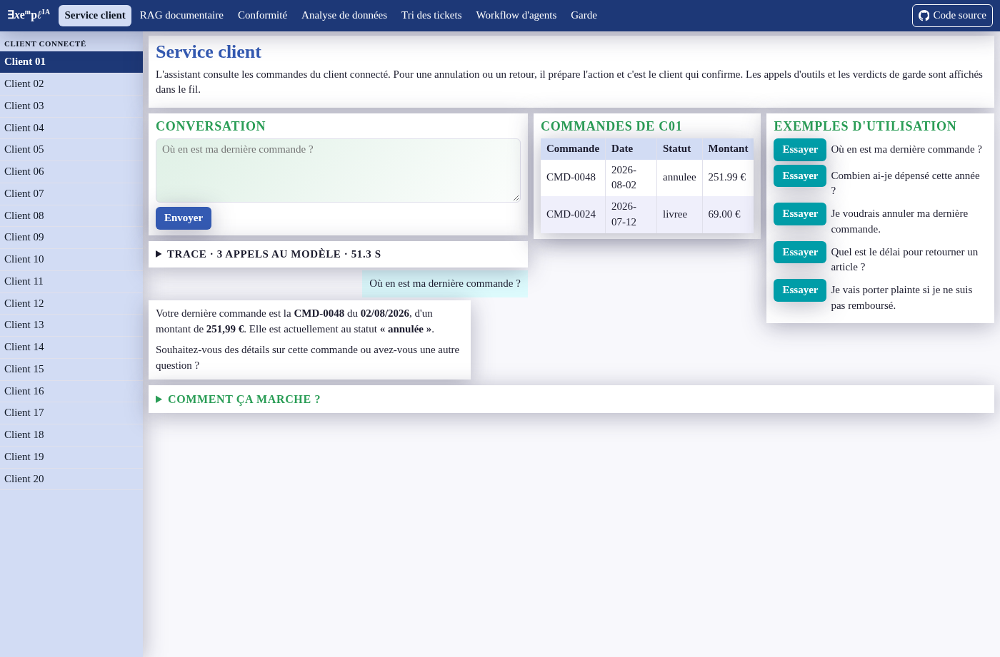

# Service client

Assistant conversationnel qui répond aux questions générales, consulte les commandes du client
connecté et prépare des actions (annulation, retour) que le client confirme lui-même.

## Besoin

Les demandes d'un service client se répartissent en trois familles, chacune avec sa technique :

| Demande | Exemple | Technique |
|---|---|---|
| Question générale | « Quel est le délai de retour ? » | Documents dans le contexte |
| Question sur ses données | « Où en est ma commande ? », « Combien ai-je dépensé cette année ? », « Le Produit B est-il plus cher que le C ? » | Outils de lecture, filtrés sur le client authentifié ; le modèle croise et calcule à partir de ce qu'ils renvoient |
| Demande d'action | « Annulez ma commande » | Outil qui prépare l'action, confirmation, exécution par le code |

## Limites

- Authentification simulée par le choix du client.
- Une question hors sujet peut recevoir une réponse du modèle malgré la consigne ; le juge la bloque
  et la conversation part chez un conseiller, ce qui est sûr mais peu naturel.
- Le retour est enregistré dans le journal, sans changement de statut de la commande (la réception
  du colis relève d'un autre processus).
- La garde d'entrée masque les données personnelles avant l'envoi au modèle, y compris celles que le
  client donne volontairement.
- Les cinq derniers tours sont envoyés au modèle, pas toute la conversation : au-delà, le prompt
  dépasse la fenêtre de contexte du serveur et la réponse est tronquée en pleine phrase, sans
  erreur. Le modèle perd donc le fil des échanges très anciens.
- Les totaux et décomptes sont calculés par le modèle à partir des résultats d'outils. Sur quelques
  commandes, c'est juste ; sur un historique long, il se trompera : aucun outil ne calcule en base
  ici, contrairement à l'exemple [analyse de données](../analyse_donnees/README.md).

La suite : [Comment ça marche ?](comment-ca-marche.md) · [Comment utiliser ?](utilisation.md) · [Évaluation](evaluation.md).
