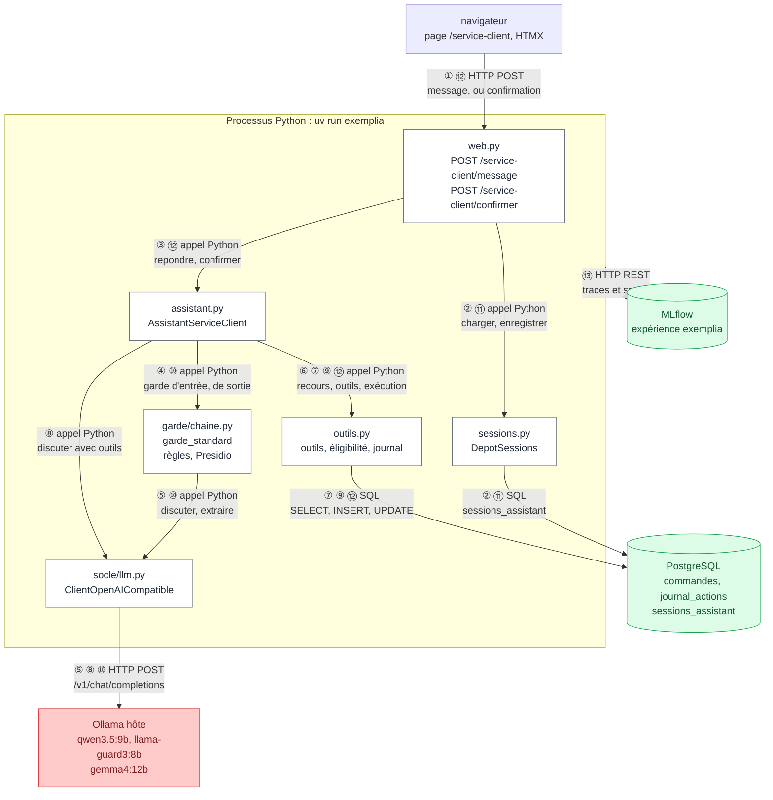

# Fonctionnement

## Détail du fonctionnement

- `client_id` vient de la session, jamais des arguments du LLM : un outil ne peut pas lire les
  commandes d'un autre client. Une commande d'un autre client répond « introuvable », comme une
  commande inexistante.
- Une menace de recours (plainte, avocat, association de consommateurs, tribunal, litige, fraude)
  est détectée par le code avant le LLM : la conversation est transférée et journalisée sans
  dépendre du modèle, qui a tendance à annoncer le transfert sans appeler l'outil.
- La boucle d'outils est bornée (`max_tours`) ; au-delà, la conversation est transférée à un
  conseiller.
- Une nouvelle demande du client annule l'action en attente précédente.
- Le résultat réel de l'action confirmée est ajouté à l'historique, pour que le LLM en tienne compte
  ensuite.
- Le juge de sortie reçoit tout ce que le modèle a reçu : documents, description du fonctionnement
  (bouton « Confirmer »), commandes du client placées dans le prompt, et résultats des outils de la
  conversation, pas seulement du tour en cours.
  Sans eux, il prend les statuts et dates des commandes pour des inventions ; limités au dernier
  tour, il bloque une réponse qui se réfère à une commande consultée trois messages plus tôt. Les
  douze derniers résultats sont conservés, pour que le prompt du juge reste borné.
- La session (historique, action en attente, escalade) est enregistrée en base après chaque requête
  (`sessions.py`, table `sessions_assistant`) : elle survit au redémarrage et fonctionne avec
  plusieurs processus.

| Outil | Type | Règle vérifiée par le code |
|---|---|---|
| `rechercher_commandes` | lecture | historique complet des commandes du client connecté |
| `detail_commande` | lecture | commande du client connecté |
| `catalogue_produits` | lecture | catalogue public : aucun filtre par client |
| `proposer_annulation` | écriture | statut `en_preparation` |
| `proposer_retour` | écriture | statut `livree`, livraison il y a 30 jours au plus, au moins un produit physique ; motif facultatif, pour que le modèle vérifie l'éligibilité sans le demander d'abord |
| `transferer_conseiller` | escalade | journalisé ; déclenché aussi par le code sur menace de recours |

## Choix d'architecture

Les documents utiles (CGV, politique de retour, FAQ) font quelques pages : ils tiennent entièrement
dans le prompt. Un RAG n'apporte rien à cette taille ; il devient nécessaire quand la base dépasse
la fenêtre de contexte utile (voir l'exemple [rag](../rag/README.md)).

Les outils de lecture donnent accès à un domaine de données, pas à une question : l'historique des
commandes, le détail d'une commande, le catalogue. Le prompt système énumère ces données, et le
modèle compose sa réponse — il croise, compte, compare, additionne. « Combien de Produit B ai-je
commandés ? » n'a pas d'outil dédié : le modèle liste les commandes, ouvre chacune et fait la somme.
Ajouter un outil par question ne passerait pas l'échelle.

Le point sensible est ailleurs : un modèle qui ignore ce qu'il peut atteindre invente une limite et
renvoie le client vers son espace client. D'où la description explicite des données dans le prompt,
et des descriptions d'outils qui disent ce qu'elles renvoient — « historique complet », pas
« liste les commandes ».

Les commandes du client (les dix plus récentes) sont placées **dans le prompt système**, en fin de
prompt, plutôt que laissées à un appel d'outil. Sans elles sous les yeux, le modèle réclame au
client une référence de commande qu'il a déjà — même quand le client n'a qu'une seule commande. La
position compte : placées avant les documents, elles étaient noyées et ignorées.

Ce contexte a une contrepartie, que l'évaluation a mise en évidence : voyant le statut d'une
commande, le modèle conclut de lui-même « déjà expédiée, donc non annulable » et répond sans appeler
`proposer_annulation`. Il court-circuite alors la vérification d'éligibilité faite par le code, qui
est justement ce que cet exemple démontre. D'où la consigne explicite : appeler l'outil d'action
même quand le statut connu laisse penser que l'action est impossible, car c'est l'outil qui décide
et qui formule la raison du refus.

Lecture et écriture passent par le même mécanisme d'appel d'outils. Ce qui les distingue, c'est le
risque, donc l'encadrement :

| | Lecture | Écriture |
|---|---|---|
| Autorisation | Le client ne voit que ses commandes | En plus : éligibilité vérifiée par le code (statut, délai, type de produit) |
| Exécution | Immédiate | Après clic « Confirmer » du client, jamais sur la seule décision du LLM |
| Robustesse | Rejouable | Idempotente : clé unique dans `journal_actions` |
| Traçabilité | Traces | Traces + journal d'audit |

## Composants de l'exemple

L'exemple est la page `/service-client` de l'application `uv run exemplia`. Le choix du client dans
le menu latéral crée une session en base ; chaque message est ensuite traité par une requête HTMX.
Les modèles sont ceux de `socle/config.py`, surchargeables par `.env` (`IACU_MODELE_CHAT`,
`IACU_MODELE_GARDE`, `IACU_MODELE_JUGE`) ; PostgreSQL est joint sur `IACU_DATABASE_URL`, Ollama sur
`IACU_LLM_BASE_URL`. L'assistant lit aussi trois documents Markdown de `data/entreprise/documents/`
(`conditions-generales-de-vente`, `politique-de-retour`, `faq`), placés en entier dans le prompt.

- **① Message.** Le formulaire envoie `session_id` et `texte` ; la réponse revient sous forme de
  fragment HTML (`evenements.html`) ajouté au fil : messages, appels d'outils, verdicts de garde,
  bouton « Confirmer » si une action est en attente.
- **② Session.** `DepotSessions.charger` relit dans `sessions_assistant` l'historique, les derniers
  résultats d'outils, l'action en attente et l'état d'escalade, stockés en JSON.
- **③ Assistant.** `web.py` construit `AssistantServiceClient` avec le client compté par `mesurer`
  et `garde_standard(client, PERIMETRE)`, puis appelle `repondre`.
- **④ Garde d'entrée, sans modèle.** Longueur, injection par règles, puis masquage des noms, emails,
  téléphones, IBAN et cartes par Presidio et spaCy `fr_core_news_md`. C'est le texte masqué qui est
  envoyé au modèle.
- **⑤ Modération.** `llama-guard3:8b` reçoit le message ; une réponse `unsafe` bloque le tour avec
  le message de refus.
- **⑥ Menace de recours.** `motif_recours` cherche par expression régulière plainte, avocat,
  tribunal, litige, fraude… ; si elle trouve, `transferer_conseiller` écrit dans `journal_actions`
  et le tour s'arrête sans appel au LLM.
- **⑦ Contexte.** `prompt_systeme` lit les commandes du client (`rechercher_commandes`, filtrée sur
  le `client_id` de la session) et place les dix plus récentes en fin de prompt, après les
  consignes et les documents.
- **⑧ Appel au LLM.** `discuter` envoie à `qwen3.5:9b` le prompt système, les cinq derniers tours
  de conversation et les six définitions d'outils (`tools`, format OpenAI). Le modèle répond par du
  texte ou par des appels d'outils.
- **⑨ Outils.** `_dispatcher` valide les arguments avec Pydantic et exécute l'outil avec le
  `client_id` de la session : lecture SQL, ou vérification d'éligibilité qui met l'action en
  attente sans rien modifier. Les résultats, délimités, sont ajoutés à l'historique et l'appel ⑧
  reprend, cinq fois au plus (`max_tours`) ; au-delà, la conversation est transférée.
- **⑩ Garde de sortie.** Fuite du prompt système, IBAN et cartes bancaires (blocage), puis juge
  `gemma4:12b` en sortie structurée (`response_format` JSON Schema), qui reçoit la question, les
  documents, la description du fonctionnement, les commandes du client et les douze derniers
  résultats d'outils. Un blocage remplace la réponse et transfère la conversation.
- **⑪ Enregistrement.** `DepotSessions.enregistrer` met à jour la ligne de `sessions_assistant`, ou
  l'insère.
- **⑫ Confirmation.** Le clic sur « Confirmer » ou « Refuser » appelle
  `POST /service-client/confirmer`. `confirmer` vérifie que l'action en attente correspond, puis
  `executer_annulation` ou `executer_retour` réévalue l'éligibilité et écrit dans `journal_actions`
  avec une clé d'idempotence ; l'annulation passe aussi la commande au statut `annulee`. Aucun appel
  au modèle à cette étape. La session est ensuite enregistrée comme en ⑪.
- **⑬ Traces.** `tracage.activer("exemplia")`, appelé au démarrage, active l'autolog OpenAI de
  MLflow : chaque appel à Ollama est tracé, ainsi que les spans `service_client.repondre` (`AGENT`),
  un span par outil (`TOOL`) et un par contrôle de garde, avec le client et la session en
  métadonnées. Si MLflow est injoignable au démarrage, le traçage est désactivé sans erreur.

**Ce que fait le GPU.** Seul Ollama calcule sur le GPU : `llama-guard3:8b` pour la modération,
`qwen3.5:9b` pour chaque tour de la boucle d'outils, `gemma4:12b` pour le juge, soit au moins trois
appels de modèle par message qui passe la garde. Presidio et spaCy, les règles de garde, la
détection des menaces de recours et l'éligibilité tournent sur le CPU du processus Python ; les
requêtes SQL, dans PostgreSQL.
