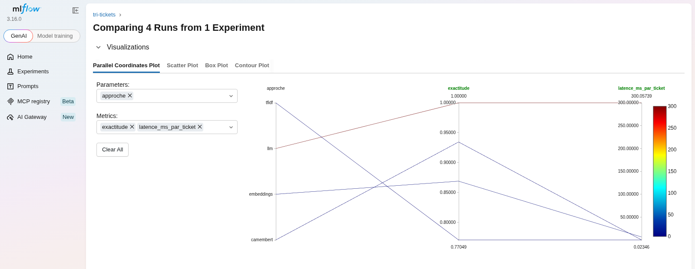
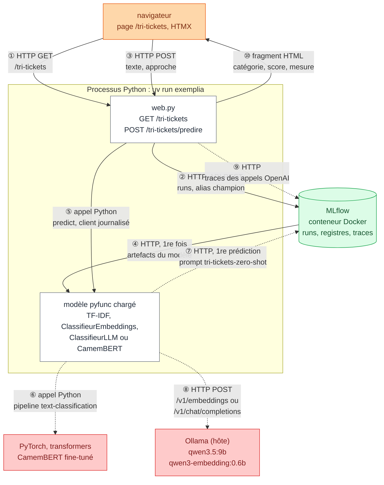
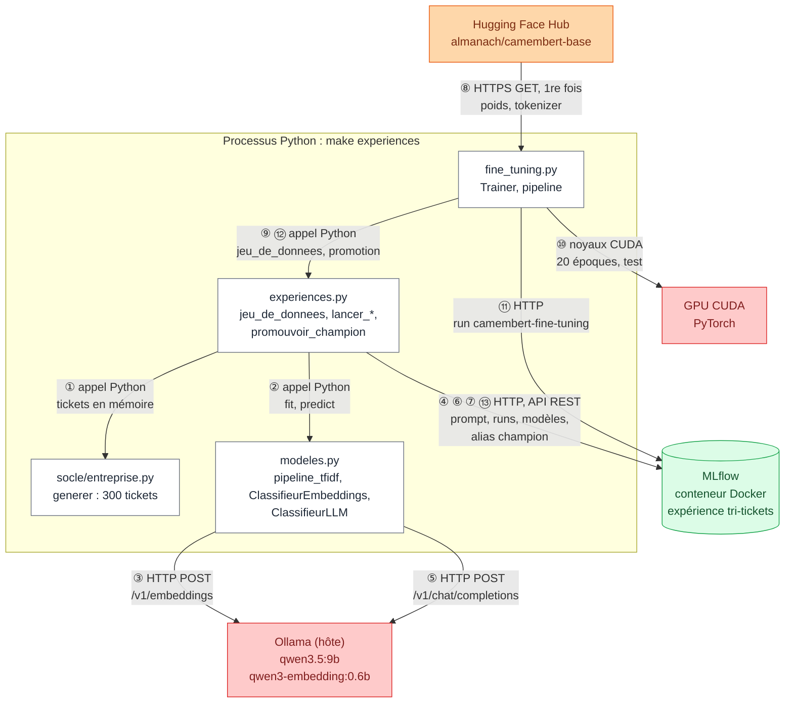

# Tri des tickets


Classification des demandes du service client en cinq catégories, traitée par plusieurs approches
comparées dans MLflow. Montre le cycle MLOps complet et répond à une question fréquente : faut-il un
LLM, ou un modèle classique suffit-il ?

## Approches

| Approche | Principe | Entraînement | Inférence |
|---|---|---|---|
| `tfidf` | TF-IDF (mots et paires de mots) + régression logistique | secondes, CPU | < 1 ms, CPU |
| `embeddings` | Embeddings du serveur de modèles + régression logistique | embeddings des 240 tickets | un appel d'embedding |
| `camembert` | CamemBERT fine-tuné (20 époques) | ~15 s, GPU | < 1 ms, GPU |
| `llm` | LLM sans exemple, prompt versionné, sortie structurée | aucun | un appel au LLM |

Jeu commun : 300 tickets, environ 80 % entraînement et 20 % test, stratifiés par catégorie. Les
tickets sont produits à partir de 14 formulations par catégorie, avec des demandes qui touchent deux
sujets et du bruit (minuscules, accents absents, fautes de frappe). La séparation se fait **par
formulation** : le test ne contient que des tournures absentes de l'entraînement. Un découpage
aléatoire placerait des quasi-doublons des deux côtés et donnerait au TF-IDF un score proche de 1
qui ne dit rien de sa tenue sur de nouveaux messages.

## Cycle MLOps

Le déroulé, diagramme compris, est dans [Comment ça marche ?](comment-ca-marche.md) — le
texte que la page affiche.



Page de comparaison de MLflow, atteinte depuis la page `/tri-tickets` : les quatre runs, `approche`
en paramètre, exactitude et latence en métriques. Chaque approche y garde ses artefacts — matrice de
confusion, rapport de classification, modèle enregistré.

## Composants de l'exemple

L'exemple a deux chemins : la prédiction, servie par la page web, et le cycle d'expériences, lancé
en ligne de commande, qui produit les modèles que la page charge.

### Prédiction dans la page web



`uv run exemplia` démarre l'application FastAPI ; le routeur de `web.py` sert la page
`/tri-tickets`. Il ne lit ni PostgreSQL ni fichier local : runs, modèles et prompt sont lus dans le
serveur MLflow (`IACU_MLFLOW_TRACKING_URI`, `http://localhost:5000` par défaut).

- **① Ouverture de la page.** Le navigateur demande `/tri-tickets` ; la page contient le formulaire
  de prédiction et les tickets d'exemple.
- **② État de MLflow.** `_etat_mlflow` interroge MLflow par son API REST : runs de l'expérience
  `tri-tickets` (`search_runs`, meilleur F1 par approche) et version du modèle `tri-tickets` qui
  porte l'alias `champion`. La page affiche la comparaison et les liens vers MLflow ; la même
  lecture est refaite à chaque prédiction.
- **③ Demande de prédiction.** HTMX envoie le texte du ticket et l'approche choisie : `champion`,
  ou l'identifiant du meilleur run d'une approche.
- **④ Chargement du modèle.** `mlflow.pyfunc.load_model` télécharge les artefacts de
  `models:/tri-tickets@champion` ou `runs:/<run_id>/modele` ; le modèle chargé est gardé en mémoire
  par référence (`lru_cache`).
- **⑤ Prédiction.** Sous `mesurer`, `_brancher_client` donne aux modèles qui appellent un serveur
  (embeddings, LLM) un `ClientJournal` qui compte les appels et retient les échanges, puis
  `predict([texte])` est appelé. Le pipeline TF-IDF calcule tout dans le processus, avec
  scikit-learn.
- **⑥ CamemBERT.** Le modèle enregistré avec `mlflow.transformers` est un pipeline
  `text-classification` exécuté par PyTorch dans le processus ; il renvoie l'étiquette et un score.
- **⑦ Prompt versionné.** `ClassifieurLLM` lit à sa première prédiction le gabarit référencé par
  son URI dans le Prompt Registry (`tri-tickets-zero-shot`), puis le garde en mémoire.
- **⑧ Appel au serveur de modèles.** `ClassifieurEmbeddings` envoie le texte à `/v1/embeddings`
  puis applique sa régression logistique ; `ClassifieurLLM` envoie le prompt, ticket encadré par
  `delimiter`, à `/v1/chat/completions` avec un `response_format` JSON Schema (classe
  `Categorie`), validé par Pydantic. Les noms de modèles sont ceux enregistrés avec le run, lus dans
  la configuration au moment de l'expérience.
- **⑨ Traces.** `tracage.activer("exemplia")`, appelé au démarrage de l'application, active
  l'autolog OpenAI : chaque appel au serveur de modèles part en trace dans l'expérience `exemplia`.
  TF-IDF et CamemBERT n'en produisent aucune.
- **⑩ Réponse.** Le fragment `prediction.html` affiche la catégorie, le score pour CamemBERT, le
  nombre d'appels, la durée et les échanges avec le modèle.

### Cycle d'expériences et fine-tuning



`make experiences` lance `uv run python -m exemplia.tri_tickets.experiences` (approches `tfidf`,
`embeddings`, `llm`), puis `uv run python -m exemplia.tri_tickets.fine_tuning --promouvoir`, qui
demande le groupe de dépendances `gpu`. Les deux scripts écrivent dans l'expérience `tri-tickets`
du serveur MLflow ; aucun ne lit PostgreSQL.

- **① Jeu de données.** `jeu_de_donnees` génère les 300 tickets en mémoire (`entreprise.generer`,
  graine fixe) et les sépare avec `StratifiedGroupKFold` : groupes par formulation d'origine,
  strates par catégorie, une part sur cinq en test.
- **② Entraînement et évaluation.** Chaque approche est un run MLflow. Le pipeline TF-IDF et les
  régressions logistiques sont entraînés par scikit-learn ; `_evaluer` prédit le jeu de test et
  mesure F1 macro, exactitude et latence par ticket.
- **③ Embeddings.** `ClassifieurEmbeddings` envoie les tickets d'entraînement, puis ceux de test,
  à `/v1/embeddings` (`IACU_MODELE_EMBEDDINGS`, `qwen3-embedding:0.6b` par défaut), en une requête
  par lot.
- **④ Prompt.** Avant le run `llm`, `mlflow.genai.register_prompt` enregistre `PROMPT_ZERO_SHOT`
  sous le nom `tri-tickets-zero-shot` ; l'URI de la version est passée au classifieur.
- **⑤ Classification par le LLM.** `ClassifieurLLM` charge ce prompt depuis le Prompt Registry et
  appelle `/v1/chat/completions` une fois par ticket de test, avec sortie structurée
  (`IACU_MODELE_CHAT`, `qwen3.5:9b` par défaut). Aucun entraînement.
- **⑥ Enregistrement des runs.** Pour chaque run : paramètres, métriques, rapport de
  classification, matrice de confusion et modèle (`mlflow.sklearn.log_model` pour TF-IDF,
  `mlflow.pyfunc.log_model` pour les deux autres, sans le client réseau).
- **⑦ Promotion.** `promouvoir_champion` retient les runs à moins d'un point du meilleur F1 macro,
  prend le plus rapide, l'enregistre comme nouvelle version de `tri-tickets` et lui donne l'alias
  `champion` et le tag `approche`. Ici, seuls les runs qui viennent d'être lancés sont comparés.
- **⑧ Modèle de base.** `fine_tuning.py` s'arrête si CUDA est absent, puis charge
  `almanach/camembert-base` (tokenizer et modèle avec une tête de classification à cinq classes),
  téléchargé depuis le Hugging Face Hub au premier lancement.
- **⑨ Même découpage.** Le script reprend `jeu_de_donnees` : le jeu de test est celui des autres
  approches.
- **⑩ Fine-tuning sur le GPU.** Le `Trainer` de transformers entraîne 20 époques (taux 5e-5, lots
  de 16, bf16 si la carte le prend en charge) et évalue à chaque époque ; un pipeline
  `text-classification` sur le GPU prédit ensuite le jeu de test pour mesurer les mêmes métriques.
- **⑪ Run CamemBERT.** Le run `camembert-fine-tuning` enregistre paramètres, métriques et le
  pipeline avec `mlflow.transformers.log_model`.
- **⑫ Promotion sur tous les runs.** Avec `--promouvoir`, `resultats_experience` relit tous les
  runs de l'expérience qui ont des métriques, fine-tuning compris, et applique la même règle.
- **⑬ Nouveau champion.** La règle crée une nouvelle version de `tri-tickets` et déplace l'alias
  `champion` ; la page le charge à la prochaine prédiction sur cet alias, sans redéploiement.

**Ce que fait le GPU.** Ollama sert sur le GPU le modèle d'embeddings et le LLM (⑧ de la prédiction, ③ et
⑤ du cycle d'expériences) : des passes avant, sans entraînement. Le seul entraînement sur le GPU est le
fine-tuning de CamemBERT (⑩), par PyTorch dans le processus du script. TF-IDF, les régressions
logistiques et les métriques tournent sur le CPU. Dans l'application web, le pipeline CamemBERT
rechargé par MLflow est placé sur le GPU quand CUDA est disponible, sinon sur le CPU (variable
`MLFLOW_DEFAULT_PREDICTION_DEVICE` pour forcer un périphérique).

## Résultats

`qwen3.5:9b` pour le LLM, `qwen3-embedding:0.6b` pour les embeddings, GPU de 12 Go :

| Approche | F1 macro | Exactitude | Latence par ticket |
|---|---|---|---|
| `llm` | 1,000 | 1,000 | 300 ms |
| `camembert` | 0,935 | 0,934 | 0,26 ms |
| `embeddings` | 0,864 | 0,869 | 6,6 ms |
| `tfidf` | 0,769 | 0,770 | 0,02 ms |

Le LLM sans exemple classe parfaitement ces tickets, y compris des formulations jamais vues, et
c'est l'approche la plus lente de trois ordres de grandeur. CamemBERT fine-tuné en 15 secondes sur
239 tickets atteint 0,935 pour une latence négligeable : sur un volume élevé, c'est le compromis à
regarder en premier.

| Élément MLflow | Usage |
|---|---|
| Expérience `tri-tickets` | Un run par approche, mêmes métriques, comparables dans l'interface |
| `mlflow.sklearn.log_model` | Pipeline TF-IDF |
| `mlflow.pyfunc.PythonModel` | Approches qui appellent un serveur (embeddings, LLM) : chargées et appelées comme le modèle scikit-learn |
| `mlflow.transformers.log_model` | CamemBERT fine-tuné |
| Prompt Registry | Prompt de classification du LLM (`tri-tickets-zero-shot`), référencé par URI dans le modèle |
| Model Registry, alias | `champion` désigne la version servie : changer de modèle = déplacer l'alias, sans redéployer l'application |

La page renvoie vers chaque point d'intégration : l'expérience et ses runs, la comparaison des
quatre runs, le Model Registry avec l'alias `champion`, et le Prompt Registry. Le nom d'une approche
ouvre son propre run (paramètres, métriques, matrice de confusion, modèle enregistré). Les
identifiants sont lus dans MLflow au moment de l'affichage : rien n'est stocké, et les liens suivent
les expériences rejouées.

La sélection des paramètres et des métriques de la page de comparaison n'est pas transmissible par
l'URL — MLflow la garde dans l'état du composant — il reste donc à cocher `exactitude` et
`latence_ms_par_ticket` à la main pour montrer le compromis.

La règle de promotion privilégie le modèle le plus rapide à qualité équivalente : un modèle
classique aussi bon qu'un LLM coûte bien moins cher à servir.

## Lancer

```bash
make experiences                                                   # les quatre approches, puis le champion
uv run python -m exemplia.tri_tickets.experiences                  # tfidf, embeddings, llm
uv run python -m exemplia.tri_tickets.experiences --approches tfidf
uv run python -m exemplia.tri_tickets.fine_tuning --promouvoir     # CamemBERT, groupe `gpu`
```

La page `/tri-tickets` classe un ticket avec le modèle de votre choix : le champion, ou n'importe
quelle approche servie depuis son meilleur run. Le même ticket passé dans les quatre montre
l'essentiel en un écran — même catégorie trouvée, trois ordres de grandeur d'écart sur le coût, et
une trace vide pour les approches qui n'appellent aucun serveur.

## Deux tickets qui séparent les approches

La page propose deux tickets dont le classement diffère d'une approche à l'autre, vérifiés sur les
modèles entraînés. Chaque essai est une ligne — un bouton qui choisit le modèle et remplit le
ticket — et le bouton orange désigne le modèle qui se trompe.

| Ticket | Attendu | tfidf | embeddings | camembert | llm |
|---|---|---|---|---|---|
| « Le colis est bien là, mais la notice annonce un autre modèle. » | produit | livraison | retour | livraison | **produit** |
| « Ma commande est bien arrivée, mais je souhaite la renvoyer. » | retour | livraison | **retour** | **retour** | **retour** |

Le premier demande de comprendre que le sujet est la notice, pas le colis : seul le LLM y arrive.
Le second suffit à tromper TF-IDF, qui compte les mots et voit « commande arrivée », là où les
représentations vectorielles saisissent l'intention.

## Limites

- Les tickets sont générés à partir de modèles de phrases : moins variés que de vrais tickets,
  donc les écarts mesurés valent pour ce jeu.
- `fine_tuning.py --promouvoir` rejoue la règle de promotion sur tous les runs de l'expérience ;
  sans l'option, le run est seulement enregistré et se compare dans l'interface MLflow.
- Le modèle de base est `almanach/camembert-base` : avec transformers 5.x, le tokenizer de
  `camembertv2-base` découpe le texte caractère par caractère et le modèle n'apprend pas.
- La latence mesurée inclut le réseau pour les approches servies (embeddings, LLM).

## Fichiers

| Fichier | Contenu |
|---|---|
| `modeles.py` | Pipeline TF-IDF, modèles pyfunc embeddings et LLM, prompt |
| `experiences.py` | Jeu de données, runs, promotion du champion |
| `fine_tuning.py` | Fine-tuning CamemBERT (groupe `gpu`) |
| `web.py`, `templates/` | Interface |
