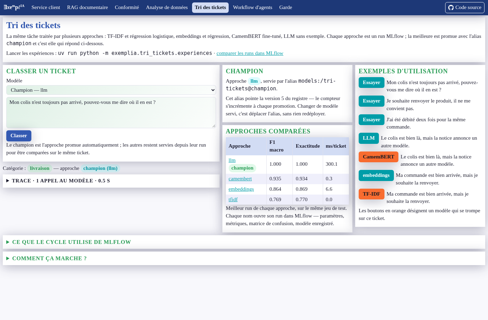

# Tri des tickets



Classification des demandes du service client en cinq catégories, traitée par plusieurs approches
comparées dans MLflow. Montre le cycle MLOps complet et répond à une question fréquente : faut-il un
LLM, ou un modèle classique suffit-il ?

## Approches

| Approche | Principe | Entraînement | Inférence |
|---|---|---|---|
| `tfidf` | TF-IDF (mots et paires de mots) + régression logistique | secondes, CPU | < 1 ms, CPU |
| `embeddings` | Embeddings du serveur de modèles + régression logistique | embeddings des 240 tickets | un appel d'embedding |
| `camembert` | CamemBERT fine-tuné (20 époques) | ~15 s, GPU | < 1 ms, GPU |
| `llm` | LLM sans exemple, prompt versionné, sortie structurée | aucun | un appel au LLM |

Jeu commun : 300 tickets, environ 80 % entraînement et 20 % test, stratifiés par catégorie. Les
tickets sont produits à partir de 14 formulations par catégorie, avec des demandes qui touchent deux
sujets et du bruit (minuscules, accents absents, fautes de frappe). La séparation se fait **par
formulation** : le test ne contient que des tournures absentes de l'entraînement. Un découpage
aléatoire placerait des quasi-doublons des deux côtés et donnerait au TF-IDF un score proche de 1
qui ne dit rien de sa tenue sur de nouveaux messages.

## Cycle MLOps

Le déroulé, diagramme compris, est dans [Comment ça marche ?](comment-ca-marche.md) — le
texte que la page affiche.


Page de comparaison de MLflow, atteinte depuis la page `/tri-tickets` : les quatre runs, `approche`
en paramètre, exactitude et latence en métriques. Chaque approche y garde ses artefacts — matrice de
confusion, rapport de classification, modèle enregistré.

## Résultats

`qwen3.5:9b` pour le LLM, `qwen3-embedding:0.6b` pour les embeddings, GPU de 12 Go :

| Approche | F1 macro | Exactitude | Latence par ticket |
|---|---|---|---|
| `llm` | 1,000 | 1,000 | 300 ms |
| `camembert` | 0,935 | 0,934 | 0,26 ms |
| `embeddings` | 0,864 | 0,869 | 6,6 ms |
| `tfidf` | 0,769 | 0,770 | 0,02 ms |

Le LLM sans exemple classe parfaitement ces tickets, y compris des formulations jamais vues, et
c'est l'approche la plus lente de trois ordres de grandeur. CamemBERT fine-tuné en 15 secondes sur
239 tickets atteint 0,935 pour une latence négligeable : sur un volume élevé, c'est le compromis à
regarder en premier.

| Élément MLflow | Usage |
|---|---|
| Expérience `tri-tickets` | Un run par approche, mêmes métriques, comparables dans l'interface |
| `mlflow.sklearn.log_model` | Pipeline TF-IDF |
| `mlflow.pyfunc.PythonModel` | Approches qui appellent un serveur (embeddings, LLM) : chargées et appelées comme le modèle scikit-learn |
| `mlflow.transformers.log_model` | CamemBERT fine-tuné |
| Prompt Registry | Prompt de classification du LLM (`tri-tickets-zero-shot`), référencé par URI dans le modèle |
| Model Registry, alias | `champion` désigne la version servie : changer de modèle = déplacer l'alias, sans redéployer l'application |

La page renvoie vers chaque point d'intégration : l'expérience et ses runs, la comparaison des
quatre runs, le Model Registry avec l'alias `champion`, et le Prompt Registry. Le nom d'une approche
ouvre son propre run (paramètres, métriques, matrice de confusion, modèle enregistré). Les
identifiants sont lus dans MLflow au moment de l'affichage : rien n'est stocké, et les liens suivent
les expériences rejouées.

La sélection des paramètres et des métriques de la page de comparaison n'est pas transmissible par
l'URL — MLflow la garde dans l'état du composant — il reste donc à cocher `exactitude` et
`latence_ms_par_ticket` à la main pour montrer le compromis.

La règle de promotion privilégie le modèle le plus rapide à qualité équivalente : un modèle
classique aussi bon qu'un LLM coûte bien moins cher à servir.

## Lancer

```bash
make experiences                                                   # les quatre approches, puis le champion
uv run python -m exemplia.tri_tickets.experiences                  # tfidf, embeddings, llm
uv run python -m exemplia.tri_tickets.experiences --approches tfidf
uv run python -m exemplia.tri_tickets.fine_tuning --promouvoir     # CamemBERT, groupe `gpu`
```

La page `/tri-tickets` classe un ticket avec le modèle de votre choix : le champion, ou n'importe
quelle approche servie depuis son meilleur run. Le même ticket passé dans les quatre montre
l'essentiel en un écran — même catégorie trouvée, trois ordres de grandeur d'écart sur le coût, et
une trace vide pour les approches qui n'appellent aucun serveur.

## Deux tickets qui séparent les approches

La page propose deux tickets dont le classement diffère d'une approche à l'autre, vérifiés sur les
modèles entraînés. Chaque essai est une ligne — un bouton qui choisit le modèle et remplit le
ticket — et le bouton orange désigne le modèle qui se trompe.

| Ticket | Attendu | tfidf | embeddings | camembert | llm |
|---|---|---|---|---|---|
| « Le colis est bien là, mais la notice annonce un autre modèle. » | produit | livraison | retour | livraison | **produit** |
| « Ma commande est bien arrivée, mais je souhaite la renvoyer. » | retour | livraison | **retour** | **retour** | **retour** |

Le premier demande de comprendre que le sujet est la notice, pas le colis : seul le LLM y arrive.
Le second suffit à tromper TF-IDF, qui compte les mots et voit « commande arrivée », là où les
représentations vectorielles saisissent l'intention.

## Limites

- Les tickets sont générés à partir de modèles de phrases : moins variés que de vrais tickets,
  donc les écarts mesurés valent pour ce jeu.
- `fine_tuning.py --promouvoir` rejoue la règle de promotion sur tous les runs de l'expérience ;
  sans l'option, le run est seulement enregistré et se compare dans l'interface MLflow.
- Le modèle de base est `almanach/camembert-base` : avec transformers 5.x, le tokenizer de
  `camembertv2-base` découpe le texte caractère par caractère et le modèle n'apprend pas.
- La latence mesurée inclut le réseau pour les approches servies (embeddings, LLM).

## Fichiers

| Fichier | Contenu |
|---|---|
| `modeles.py` | Pipeline TF-IDF, modèles pyfunc embeddings et LLM, prompt |
| `experiences.py` | Jeu de données, runs, promotion du champion |
| `fine_tuning.py` | Fine-tuning CamemBERT (groupe `gpu`) |
| `web.py`, `templates/` | Interface |
