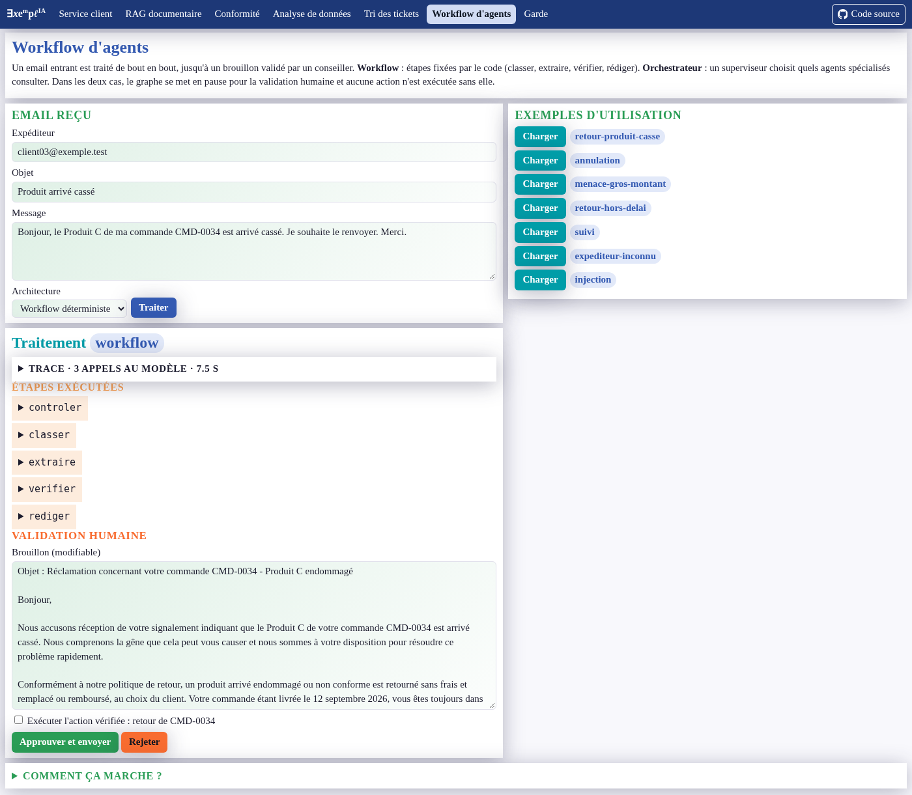

# Workflow d'agents

Traitement de bout en bout d'un email entrant au service client, jusqu'à un brouillon de réponse
validé par un conseiller, avec deux architectures comparables.

## Deux architectures

| | Workflow déterministe | Agent orchestrateur |
|---|---|---|
| Qui décide des étapes | Le code | Un LLM superviseur |
| Appels LLM | 3 par email (aucun si l'expéditeur est inconnu ou l'email suspect) | Variable (superviseur + agents consultés) |
| Prévisibilité, test | Élevées : chaque étape se teste seule | Plus faibles : dépend des choix du superviseur |
| Adaptation aux cas imprévus | Faible : il faut ajouter une branche | Élevée |
| Usage | La majorité des traitements en production | Demandes dont on ne peut pas figer le déroulé |

Dans les deux cas, le graphe **se met en pause avant tout envoi** (`interrupt` de LangGraph), et
l'action demandée (annulation, retour) n'est exécutée qu'avec l'accord explicite du conseiller.

## Limites

- L'application web enregistre l'état des traitements en pause dans PostgreSQL
  (`PostgresSaver`, tables `checkpoint*`) : une validation peut avoir lieu après un redémarrage ou
  sur un autre processus. Les tests et l'évaluation utilisent le checkpointer en mémoire.
- L'identification du client par l'adresse email ne suffit pas à authentifier l'expéditeur (adresse
  usurpable) : d'où la validation humaine avant toute action.

La suite : [Comment ça marche ?](comment-ca-marche.md) · [Comment utiliser ?](utilisation.md) · [Évaluation](evaluation.md).
