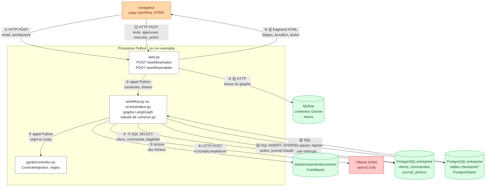

# Fonctionnement

## Workflow déterministe

| Nœud | Rôle |
|---|---|
| `controler` | Identifie le client par l'adresse d'expédition, détecte les formulations d'injection et les menaces de recours (code). Un email d'expéditeur inconnu ou suspect va directement au conseiller avec une réponse d'attente écrite par le code |
| `classer` | Catégorie et urgence (sortie structurée) |
| `extraire` | Référence de commande, type de demande, résumé, menace juridique |
| `verifier` | Faits vérifiés par le code : commande du client, éligibilité, règles d'escalade du guide interne (menace juridique, montant > 300 €) |
| `rediger` | Brouillon à partir des faits vérifiés et des politiques |
| `validation_humaine` | Pause : le conseiller corrige, approuve ou rejette, et choisit d'exécuter ou non l'action |
| `envoyer` | Exécute l'action si demandée (idempotente), journalise la réponse |

## Agent orchestrateur

Le superviseur choisit les agents à consulter. Les garde-fous restent dans le code :

- nombre d'étapes borné (`max_etapes`) ;
- sous-agent commandes limité aux données du client identifié ;
- action retenue seulement si le code confirme son éligibilité, avec la même règle d'escalade au-delà
  de 300 € que le workflow ;
- l'agent de rédaction reçoit les réponses des autres agents et les motifs d'escalade : sans elles,
  il invente l'issue de la demande (« votre commande a bien été annulée ») ;
- `completer_brouillon` fait rédiger un brouillon si le superviseur s'est arrêté sans le demander.

## Composants de l'exemple

`uv run exemplia` démarre l'application FastAPI ; le routeur de `web.py` sert la page `/workflow`.
Les deux graphes lisent les commandes dans PostgreSQL (`IACU_DATABASE_URL`), les politiques dans
`data/entreprise/documents`, et appellent le serveur de modèles par l'API compatible OpenAI
(`IACU_LLM_BASE_URL`, `IACU_MODELE_CHAT`, `qwen3.5:9b` par défaut). Le checkpointer est le
`PostgresSaver` de LangGraph, sur la même base, créé une fois par `dep_checkpointer`.

- **① Traitement demandé.** HTMX envoie l'expéditeur, l'objet, le corps et l'architecture
  (`workflow` ou `orchestrateur`) à `POST /workflow/traiter`, qui crée l'identifiant du
  traitement, `<architecture>-<uuid>`, utilisé comme `thread_id`.
- **② Construction et exécution.** Sous `mesurer`, qui enveloppe le client LLM dans un
  `ClientJournal`, `construire_workflow` ou `construire_orchestrateur` compile le graphe ;
  `_executer` le déroule avec `graph.stream` dans un span MLflow `workflow.executer`, tagué avec
  l'exemple et l'architecture.
- **③ Politiques.** À la construction, `politique-de-retour`, `conditions-generales-de-vente` et
  `guide-interne-service-client` sont lus et encadrés par `delimiter`.
- **④ Identification.** Le nœud `controler` cherche le client par l'adresse d'expédition
  (table `clients`).
- **⑤ Contrôle d'injection.** `ControleInjection`, instancié sans classifieur, applique les règles
  de la garde à l'objet et au corps ; `motif_recours` repère les menaces de recours. Un expéditeur
  inconnu ou un email suspect va directement à `validation_humaine` avec la réponse d'attente
  écrite par le code, sans appel au LLM.
- **⑥ Appels au LLM.** Le workflow fait trois appels : `classer` et `extraire` en sortie
  structurée JSON Schema, `rediger` en texte libre. L'orchestrateur appelle le superviseur avec
  cinq outils (agents commandes, documentation, rédaction, `proposer_action`,
  `signaler_escalade`), dans la limite de `max_etapes` (6), et chaque agent consulté fait ses
  propres appels ; l'agent commandes a jusqu'à trois tours d'appels d'outils. `completer_brouillon`
  fait rédiger un brouillon si le superviseur n'en a pas demandé.
- **⑦ Vérifications par le code.** `verifier_commande` lit la commande du client identifié, puis
  l'éligibilité à l'annulation ou au retour (`service_client/outils.py`), et ajoute un motif
  d'escalade au-delà de 300 €. Dans l'orchestrateur, `proposer_action` et les outils de l'agent
  commandes passent par les mêmes fonctions.
- **⑧ Pause.** LangGraph écrit l'état dans les tables `checkpoint*` après chaque nœud ;
  `validation_humaine` appelle `interrupt` avec le brouillon, les motifs d'escalade et l'action
  proposée, et le graphe s'arrête.
- **⑨ Traces.** L'autolog LangChain trace chaque nœud et l'autolog OpenAI chaque appel au modèle,
  sous le span `workflow.executer`, envoyés dans l'expérience `exemplia`.
- **⑩ Affichage.** Le fragment `traitement.html` montre les étapes exécutées, l'état de chaque
  nœud, le brouillon, l'action proposée, les motifs d'escalade, le nombre d'appels et la durée.
- **⑪ Validation.** Le conseiller corrige le texte, approuve ou rejette, et choisit d'exécuter ou
  non l'action ; `POST /workflow/valider` reçoit ces champs et l'identifiant.
- **⑫ Reprise.** `web.py` reconstruit le graphe de l'architecture tirée de l'identifiant, vérifie
  qu'un traitement est en attente, puis reprend avec `Command(resume=decision)` depuis l'état
  enregistré.
- **⑬ Envoi.** Si le brouillon est approuvé, `envoyer` exécute l'action demandée (annulation :
  `UPDATE commandes` ; retour : demande enregistrée), chacune protégée par une clé d'idempotence
  dans `journal_actions`, puis journalise la réponse. Sinon, `cloturer` marque le traitement
  rejeté.
- **⑭ ⑮ Traces et réponse** de la reprise, comme en ⑨ et ⑩.

**Ce que fait le GPU.** Seul Ollama calcule sur le GPU (⑥) : des passes avant de `qwen3.5:9b`,
sans entraînement. Le contrôle d'injection, l'identification, l'éligibilité, les règles d'escalade
et l'exécution des actions sont du code Python et du SQL, sur le CPU.
